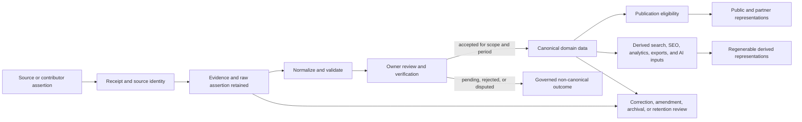

# Data Architecture and Data Lifecycle

## 1. Document Information

| Field | Value |
| --- | --- |
| Document ID | ARC-003 |
| Title | Data Architecture and Data Lifecycle |
| Project | eStudent.pk — Institutes & Education Directory |
| Status | Approved architecture document |
| Documentation language | English |
| Repository | `estudent-listing` |
| Default branch | `main` |
| Last updated | 2026-09-07 |

This document defines technology-neutral principles for the meaning, governance, lifecycle, and traceability of project data. It is not a physical data design.

## 2. Purpose and Scope

ARC-003 establishes how information is classified, owned, received, assessed, corrected, preserved, published, derived, retained, and retired before database, API, or platform design begins. It applies to directory facts, supporting records, public representations, contributions, editorial material, and AI-assisted outputs.

## 3. Relationship to Governing Documents

This document implements the data principles and documentation-first direction in [FND-001](../00-foundation/MASTER_PROJECT_INDEX.md) and [FND-002](../00-foundation/PROJECT_CONSTITUTION.md). It applies the system boundaries in [ARC-001](SYSTEM_ARCHITECTURE.md) and the owning contexts and conceptual distinctions in [ARC-002](DOMAIN_MODEL_AND_BOUNDED_CONTEXTS.md). Where an applicable approved governing document conflicts, the Constitution's hierarchy and change process apply.

## 4. Data Architecture Principles

- Meaning, ownership, provenance, verification, temporal applicability, and correction paths are first-class data concerns.
- A copy, display, collection, or transformation does not acquire ownership of a fact.
- Data is fit for use only in the scope, period, and verification state it declares.
- Technology choices must remain replaceable without changing core data meaning or public-URL commitments.
- Material change, uncertainty, and absence of evidence must be represented rather than hidden.

## 5. Information Classes

The architecture distinguishes canonical data, source data, evidence, reference data, editorial data, user-generated data, AI-generated or AI-assisted data, and derived data. A record may be related to more than one class, but its role in a given claim must remain explicit; for example, an official notice may be source evidence for a canonical fee fact without being that fact itself.

## 6. Canonical Data

Canonical data is the governed representation accepted by the primary owning context as authoritative for a declared domain fact, scope, and period. It must retain stable identity, ownership, provenance links, verification state, applicability, correction history, and publication eligibility appropriate to the claim. Collection alone does not make data canonical.

## 7. Derived Data

Derived data is a regenerable representation computed, assembled, summarized, indexed, cached, exported, or otherwise produced from governed inputs. It must identify its inputs or lineage, transformation purpose, generation or refresh context, and freshness where material. It must never silently become the source of truth.

## 8. Reference Data

Reference data provides reusable controlled meanings such as institution categories, geographic concepts, program classifications, fee types, verification states, or source types. Its ownership, versioning, and change history must be governed because changing a shared term can change the meaning of many facts. This section does not prescribe a taxonomy or storage method.

## 9. External-Source Data

External-source data is an attributable assertion, document, feed, observation, or other information received from outside the project. It retains source identity, source reference, collection context, supplied dates, relevant permissions or restrictions, and the assertion as received where appropriate. It is evidence or a proposed change until governed acceptance.

## 10. User-Generated Data

Reviews, ratings, corrections, claims, and other user contributions remain distinguishable from institutional facts, editorial material, external-source assertions, and AI output. Contributor accountability, consent, moderation, visibility, abuse handling, correction, and retention require later specifications; a contribution never independently changes a canonical fact.

## 11. Editorial Data

Editorial data includes explanatory, curated, comparative, navigational, and interpretive material owned by the Editorial and Content context. It may cite or reference canonical facts, but it does not own the facts it describes. Editorial claims require appropriate attribution, review, correction, and history, and must not imply verification beyond their support.

## 12. AI-Generated and AI-Assisted Data

AI may assist classification, extraction, summarization, translation, possible-change detection, discovery, or review. Every AI output remains distinguishable, attributable to its governed inputs and process context, and subject to review appropriate to its use. Plausibility, confidence, or presentation quality never makes AI output canonical or verified automatically.

## 13. Data Ownership

Each canonical concept has one primary owning context as defined by ARC-002. Ownership means responsibility for semantics, validation, lifecycle, correction handling, history, and publication eligibility—not exclusive possession of every copy. Institution, Campus, Location, Program, and Program Offering remain separate concepts with separate relationships and lifecycles.

## 14. Data Stewardship

Stewardship is the accountable care of data within the owner's rules: maintaining quality, resolving ambiguity, coordinating review, monitoring freshness, and initiating correction or retirement. A steward may operate a workflow but does not override domain ownership, verification requirements, or governing approval.

## 15. Data Provenance

Material claims need traceable provenance sufficient to answer what was asserted, by whom or what source, when it was collected, what scope and period it concerned, how it was assessed, and why it was accepted, rejected, amended, or published. Provenance must survive transformations and corrections at an appropriate conceptual level.

## 16. Source Identity

A source identity distinguishes the origin and authority context of supplied information, including source type, publisher or submitting actor where known, reference location, collection method or context, and relevant scope. Source identity is not a universal trust ranking and does not itself establish canonical truth.

## 17. Evidence and Supporting Records

Evidence supports an assertion or decision and can include documents, notices, official pages, correspondence, observations, media, or retained source extracts. Supporting records must be linked without treating media or a source copy as automatic proof. Evidence availability, rights, access limits, and retention sensitivity must be considered in later implementation plans.

## 18. Verification States

Verification states communicate the governed assessment of a claim, such as pending, verified, disputed, rejected, superseded, expired, or unable to verify, with exact state definitions deferred to later specification. Verification is distinct from source identity, confidence, editorial approval, and publication status; transitions require accountable review or an approved governed process.

## 19. Confidence and Quality Concepts

Confidence expresses the assessed support or uncertainty of a claim or process outcome, while quality expresses fitness against defined dimensions. Neither substitutes for verification or publication governance. Measurements and thresholds must be documented before use so an apparent score does not conceal source limitations or material uncertainty.

## 20. Freshness and Staleness

Freshness describes when information was collected, checked, updated, or last confirmed in relation to the fact's volatility. Staleness is a governed condition requiring assessment, not proof that a fact is false. Material facts may need refresh expectations, warnings, review queues, or withdrawal from publication, determined later by their owning contexts.

## 21. Effective Dates and Temporal Applicability

Facts may have distinct asserted, collected, verified, published, effective-from, effective-to, and superseded times. Fees, admissions, merit, scholarships, recognition/accreditation, programs, locations, contact details, and institutional status particularly require scope and applicability periods where material. Absence of a supplied date must remain visible rather than invented.

## 22. Historical Preservation

Historically meaningful information must not be silently destroyed by overwriting it with a later value. The architecture must preserve enough context to answer period-specific questions, such as a prior fee, merit outcome, campus offering, recognition scope, or institutional status, without asserting that older information remains current.

## 23. Corrections and Amendment History

Corrections record what changed, why, who or what initiated it, the supporting basis, assessment outcome, and relevant times. An amendment should preserve appropriate traceability to the prior representation, including whether it corrects an error, updates a new period, resolves a dispute, or retires a claim. Corrections do not require public exposure of sensitive operational detail.

## 24. Conflicting Source Handling

Conflicting assertions must be retained or linked sufficiently to understand the conflict, then resolved through the owning context's governed process. Resolution considers scope, timing, source identity, evidence, verification, and applicability; it must not silently replace one claim merely because another was collected later. Unresolved conflict may limit confidence or publication.

## 25. Data Ingestion Lifecycle

Ingestion is controlled receipt, registration, preservation, normalization, validation, and routing of information for assessment. It separates received assertions from accepted facts and supports manual, future automated, and AI-assisted intake without requiring any of them now.

## 26. Data Normalization

Normalization means reconciling received information to governed concepts, reference meanings, formats, scopes, identities, and relationships without erasing the original assertion. It is conceptual data preparation, not a prescribed relational-model technique, schema, or storage engine.

## 27. Data Validation

Validation checks completeness, format, internal consistency, relationship plausibility, temporal coherence, source requirements, and policy constraints appropriate to a claim. Validation can flag issues but does not alone verify truth or authorize publication; human or governed process review remains necessary where risk warrants it.

## 28. Data Review

Review assesses source support, conflicts, applicability, quality, privacy, and publication risk under the responsible owner's policy. Reviews must have accountable context and outcomes, including pending or unable-to-verify outcomes. Automation may assist triage but must not conceal decision responsibility.

## 29. Publication Eligibility

Publication eligibility is the decision that a governed representation may be made available for a defined audience and purpose. It is separate from canonical acceptance: a canonical fact may be withheld for privacy, uncertainty, sensitivity, rights, temporal expiry, or incomplete presentation context. Public representation must not overstate verification, freshness, or applicability.

## 30. Publication Lifecycle

Publication moves eligible information through governed availability, update, correction, withdrawal, and archival states. A published page, feed, search result, or export is a representation, not the owner of the fact. Material changes must propagate or be disclosed according to later specifications without requiring a particular delivery mechanism.

## 31. Archival and Deprecation

Archival preserves information that is no longer current but remains historically, operationally, or legally relevant. Deprecation identifies a concept, representation, reference value, or contract as being replaced, with rationale, owner, compatibility impact, replacement direction, and exit criteria. Neither means silent deletion.

## 32. Deletion and Retention Principles

Retention and deletion are governed by purpose, sensitivity, provenance needs, correction and dispute handling, rights, operational continuity, and later legal assessment. Irreversible deletion requires heightened review. When deletion is appropriate, dependent derived data, exports, access rights, and historical traceability must be considered without retaining personal data unnecessarily.

## 33. Identity and Stable Identifiers

Canonical concepts require stable identity independent of mutable names, URLs, indexes, external identifiers, or presentation labels. External identifiers must retain their source scope and may change, collide, or disappear. Identifier changes, merges, splits, and retirement require traceability and compatibility assessment rather than reusing identity silently.

## 34. Relationships Between Entities and References

Relationships must express the governed meaning, scope, and period of association rather than flattening distinct concepts. An Institution can have multiple Campuses; a Campus relates to a Location; a Program remains distinct from a Program Offering; and an Offering may vary by institution, campus, intake, admissions, fees, or merit. References do not transfer ownership.

## 35. Data Lineage

Lineage traces the path from source assertion and evidence through normalization, validation, review, canonical acceptance, publication, and derivation. It must support investigation of material claims and derived outputs, including which canonical version or governed input informed a result, without prescribing event, workflow, or storage technology.

## 36. Derived Indexes and Search Representations

Search indexes, filters, rankings, autocomplete records, comparison inputs, nearby-discovery representations, and caches are derived data owned by their consuming contexts for retrieval purposes. They must be rebuildable from governed data, carry material freshness or transformation context, and never redefine Institution, Campus, Location, Program, or Program Offering truth.

## 37. SEO Representations as Derived Data

SEO metadata, structured representations, canonical public-page representations, internal linking outputs, and landing-page inputs derive from governed canonical and approved editorial information. They must follow URL governance in FND-001, FND-002, and ARC-001, remain correctable and regenerable, and never become authoritative facts merely because they are publicly indexed.

## 38. Analytics Data as Derived Data

Analytics observations, aggregates, and reporting representations support measurement and investigation but do not own or redefine directory facts. They require purpose limitation, minimization, access governance, retention direction, and separation from canonical domain decisions. Their absence or failure must not alter core data meaning or publication eligibility.

## 39. AI Data Flow and Governance

AI consumes only governed, appropriately permissioned inputs for approved purposes and produces labelled, reviewable outputs with input basis, process context, limitations, and lifecycle direction where material. AI outputs may support proposed changes, editorial drafts, search assistance, or analytics, but must not write canonical facts or publish authoritative claims without accountable governed acceptance.

## 40. Data Quality Dimensions

Quality is assessed conceptually through dimensions including accuracy, completeness, consistency, validity, timeliness, provenance traceability, uniqueness or identity integrity, relevance, accessibility to authorized users, and fitness for declared purpose. Owners must define material measures, acceptable states, monitoring direction, and remediation priorities before operating at scale.

## 41. Privacy and Sensitive-Data Boundaries

Institutional directory information is not presumed free of privacy, safety, rights, or sensitivity concerns. Personal data, contributor identity, contact details, private evidence, access credentials, and sensitive operational records require explicit purpose, minimization, access, retention, correction, and deletion direction before collection or publication. This document makes no legal compliance claim.

## 42. Security and Access Principles

Access follows least privilege, separation of duties where appropriate, secure defaults, accountable change, and auditable handling of sensitive or material data. Read, contribute, review, approve, correct, export, and administer capabilities must be governed separately as later specifications define them. Access to a copy does not grant authority to alter canonical meaning.

## 43. Backup and Recovery Principles

Future operations must protect data integrity, provenance, history, and recoverability through proportionate backup, restoration, continuity, and validation direction. Recovery must not silently reintroduce obsolete, unauthorized, or untraceable information. This is a conceptual requirement and approves no infrastructure, provider, schedule, or recovery technology.

## 44. Data Migration and Evolution Principles

Changes to meanings, references, identifiers, relationships, temporal interpretation, or publication representations require documented impact analysis, compatibility direction, migration approach, validation, ownership, and approval. Migration must preserve provenance and historical meaning where practical; a technology replacement must not force loss of canonical identity or data history.

## 45. Data Interoperability and Future API Readiness

Data should retain explicit identity, ownership, scope, period, provenance, verification, and relationship semantics so future APIs, mobile applications, automated ingestion, maps, search, analytics, exports, and partner integrations can use governed contracts. This readiness does not approve API schemas, endpoints, formats, authentication, or integrations.

## 46. Data Architecture Governance

Material data changes must identify affected contexts, owners, information classes, source and evidence handling, verification, temporal semantics, quality, privacy, security, retention, derived representations, compatibility, and migration implications. Requirements, approved decisions, assumptions, risks, and future ideas must remain distinct. Approved documentation, not a stored implementation artifact, governs meaning.

## 47. Data-Related ADR and RFC Requirements

A durable choice affecting canonical ownership, identity, provenance, verification, temporal preservation, retention, interoperability, privacy, security, or derived-data authority requires an `ADR-xxx` record under FND-002. A significant proposed change in those areas should use an `RFC-xxx` before approval, stating rationale, alternatives, risks, affected documents, compatibility, migration, validation, and requested decision.

## 48. Current Data Architecture Status

ARC-003 approves the conceptual data architecture and lifecycle principles in this document. It does **not** approve a database engine, database technology, tables, columns, SQL schema, migrations, ORM models, framework, API implementation, application code, deployment configuration, hosting configuration, vendor, production infrastructure, data-retention schedule, or physical security design. No implementation artifact is created by this document.

## 49. Future Data Architecture Areas

Later approved work may define logical and physical data models, controlled vocabularies, verification-state definitions, quality metrics, retention schedules, privacy assessments, ingestion specifications, review workflows, search and SEO representation specifications, AI governance specifications, API contracts, migration runbooks, backup and recovery objectives, and operational access models. These remain future work and require their own documentation, review, and approval.
