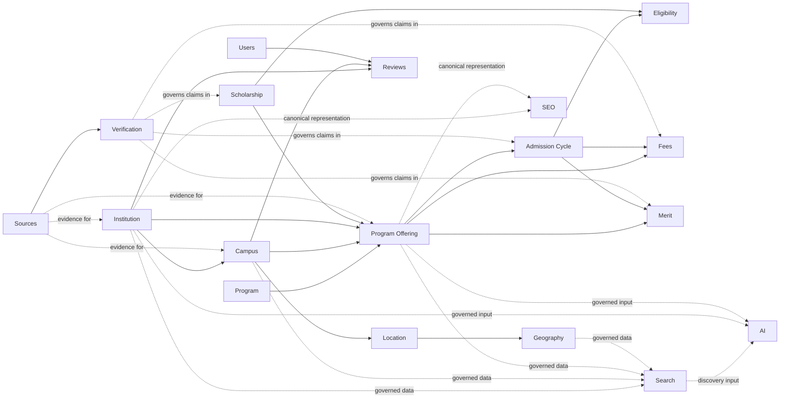

# Domain Model and Bounded Contexts

## 1. Document Information

| Field | Value |
| --- | --- |
| Document ID | ARC-002 |
| Title | Domain Model and Bounded Contexts |
| Project | eStudent.pk — Institutes & Education Directory |
| Status | Approved architecture foundation |
| Documentation language | English |
| Permanent public module root | <https://estudent.pk/institutes/> |
| Governing documents | [FND-001 Master Project Index](../00-foundation/MASTER_PROJECT_INDEX.md); [FND-002 Project Constitution](../00-foundation/PROJECT_CONSTITUTION.md); [ARC-001 System Architecture](SYSTEM_ARCHITECTURE.md) |
| Last updated | 2026-09-07 |

## 2. Purpose

This document defines the technology-neutral conceptual business model and bounded-context direction for the directory. It prevents the Institute concept from becoming an oversized container for locations, programs, admissions, fees, content, discovery, and user activity. It establishes ownership, relationship, dependency, provenance, and evolution rules; it does not define an implementation design.

## 3. Relationship to ARC-001

ARC-001 establishes the high-level system boundary, platform-layer responsibilities, and architecture-wide dependency direction. ARC-002 refines its Domain Architecture into conceptual bounded contexts and governed relationships. It remains subject to the Project Constitution and does not turn ARC-001's conceptual layers into services, schemas, APIs, or deployment components.

## 4. Domain Modeling Principles

- Model durable business meaning before presentation, collection method, or technology.
- Give each material concept a clear owning context; consumers may reference or represent it but do not redefine it.
- Separate identity, facts, evidence, verification, publication eligibility, and derived presentation.
- Preserve provenance, applicability, freshness, correction paths, and history where change affects meaning.
- Prefer explicit, directional relationships and avoid circular dependencies.
- Support different types of education provider without making one category's present attributes permanent universal assumptions.
- Keep the permanent public module root stable while allowing later approved public representations to evolve.

## 5. Core Domain Concepts

The core conceptual chain is **Institution → Campus → Program Offering**. An Institution is the enduring educational organization about which facts are asserted. A Campus is an operational presence of that organization. A Program is a reusable academic concept, while a Program Offering is that program's availability at a particular campus or institution under applicable conditions.

An Institution is not automatically a Campus, Location, website, Program, brand, or legal entity. A website can describe several institutions or campuses; a brand can span organizations; a legal or administrative entity can operate one or many institutions; and a program can be offered by many campuses. These distinctions preserve accurate relationships through expansion, merger, closure, rebranding, and correction.

## 6. Institute / Institution Identity Context

This context owns the directory's canonical institution identity: the enduring educational organization, its identity continuity, names and aliases, classification where governed, status, and relationships that describe identity without absorbing other contexts. It is the anchor for assertions but is not the owner of every fact asserted about it.

Identity must remain distinct from an external-source record, a page, an AI interpretation, or an individual user's account. Later specifications may define identity matching, mergers, splits, closures, aliases, and correction processes while preserving traceability.

## 7. Organization Identity and Legal/Administrative Identity

Organization identity describes the entity recognized by the directory as an educational organization. Legal and administrative identity describes potentially separate operating, governing, licensing, ownership, or administrative subjects. They may coincide, but this document does not assume they always do.

A brand, governing body, operator, or legal entity can relate to more than one institution, and an institution can have historically changing administrative relationships. Such relationships require deliberate provenance and temporal treatment; they must not be inferred merely from a shared name or website.

## 8. Campus and Location Context

This context owns campus identity and campus-to-location relationships. A single organization may have one campus or multiple main, satellite, branch, or city-based campuses. A campus may have operational status and periods of operation independent from the institution's continuing identity.

Location is independently modeled because a campus can move, use multiple locations, or have a service or mailing address distinct from its primary physical presence. Location information is not evidence that two institutions are the same organization.

## 9. Geography Context

Geography is reusable domain knowledge, owned independently of institutions and discovery features. It supports a hierarchy such as Country → Province/Region → Division → District → Tehsil/Subdivision → City → Locality/Area, while allowing a record to have only the levels known or applicable.

Geography provides normalized contextual meaning for locations, geographic navigation, and nearby discovery. It does not require precise coordinates, a map provider, or every hierarchy level for every record.

## 10. Academic Program Context

This context owns reusable program concepts, qualification or award context, and program lifecycle meaning. Programs must not exist only as ungoverned text embedded in an institute page. The model can evolve to accommodate degrees, diplomas, certificates, undergraduate, postgraduate, doctoral, professional, technical, and short-course forms without hard-coding current categories as permanent limits.

A Program Offering is owned as the contextual availability relationship between an Institution or Campus and a Program. It may have availability periods and relevant delivery or academic context, without making the underlying Program campus-specific.

## 11. Academic Discipline / Field of Study Context

This context owns reusable disciplines, fields of study, and their governed relationships to Programs. It distinguishes the subject area from an individual qualification, offering, or promotional label. A program may relate to one or more disciplines, and a discipline may relate to many programs.

Taxonomy change, aliases, and evolving education terminology must preserve meaning and traceability rather than rewrite historical program context without record.

## 12. Admissions Context

Admissions owns governed information about applying and admission cycles, including applicable institution, campus, program offering, intake, eligibility, deadlines, and admission method. It consumes those concepts where relevant but does not own institutional, campus, program, or user identity.

Admissions is separate because its rules and published information can change independently by campus, offering, intake, and cycle. It must retain applicable period, source, and verification context.

## 13. Eligibility Context

Eligibility owns stated applicant requirements, routes, conditions, and applicability. It can be associated with an admission cycle, program offering, scholarship, or other governed opportunity. Eligibility is not a universal personal judgment about a user and does not establish an admission outcome.

Where requirements are incomplete, conditional, sourced externally, or unverified, that status must remain visible to the governed publication process.

## 14. Fees and Financial Information Context

Fees and financial information owns published charges, ranges, fee types, terms, caveats, and applicability—not payment processing or financial transactions. A fee value must be contextualized as applicable by institution, campus, program or offering, intake/session, fee type, effective period, source, and verification state as appropriate.

Fees are time-sensitive and independently owned. They must not be treated as permanent attributes of an institution or silently overwritten when a new value is received.

## 15. Merit Context

Merit owns selection thresholds, merit lists or values, merit type, and associated qualification context. It is distinct from general Program information and can relate to a program offering, admission cycle, category or quota where applicable, year/session, source, and verification state.

Merit publication must not claim comparability across different categories, cycles, or methods when that context is absent.

## 16. Scholarship and Financial Aid Context

This context owns scholarship and financial-aid opportunity information, including provider, funding type, application period, conditions, and lifecycle. It can relate to an institution, program or offering, location, and student eligibility without becoming part of institute identity.

It communicates opportunities; it does not represent a payment, award decision, or funding commitment. Its sources, applicable period, and verification status remain governed separately.

## 17. Academic Calendar / Intake Context

This context owns reusable academic periods, intakes, sessions, and cycles relevant to program availability and admissions. It provides the temporal reference needed to distinguish the same offering or admission process across periods.

An intake or session does not redefine a Program or Institution. It is referenced by Admissions, Fees, Merit, and Program Offerings where applicable.

## 18. Facilities and Services Context

This context owns governed descriptions of facilities, services, accessibility-relevant provisions, and their applicability to an institution or campus. Campus-level ownership is often necessary because facilities may differ by campus.

Claims about facilities require their own source, verification, and effective-period context where material. They must not be inferred from the institution category or promotional content.

## 19. Accreditation / Recognition Context

This context owns claims and evidence about recognition, accreditation, affiliation, licensing, or equivalent status, including scope and effective period. Such a claim may apply to an institution, organization, campus, program, or offering; it must not be generalized beyond its supported scope.

Recognition and accreditation are time-sensitive, source-dependent facts. This context does not decide legal validity or make unverified claims authoritative.

## 20. Rankings and Reputation Context

This context owns attributable ranking, rating, award, and reputation information from governed sources, including methodology or scope where available. It distinguishes an externally published ranking from user reviews, editorial assessment, verified institutional facts, or an AI recommendation.

A rank or reputation signal must retain period, scope, source, and verification context and must not become a substitute for institutional identity or quality assurance.

## 21. Reviews and User Contributions Context

This context owns user-generated reviews, ratings, corrections, and other contributions, with their attribution, moderation, consent, visibility, abuse handling, and retention direction subject to later approval. Users may contribute information about institutions, campuses, or offerings, but contribution does not grant ownership of the referenced canonical fact.

User-generated content is always distinguishable from verified institutional facts, editorial content, third-party sourced information, and AI-generated content. Reviews do not override verified facts.

## 22. Editorial and Content Context

This context owns explanatory, curated, navigational, and editorial material. It may reference canonical entities and governed facts, but an editorial page or description is not the owner of an Institute, Program, Fee, or Admission fact.

Editorial claims need attribution, review, correction, and appropriate provenance. Editorial interpretation must remain distinguishable from verified institutional data and user contribution.

## 23. Data Source and Ingestion Context

This context owns source identity and controlled receipt of external information, including source type, source location or reference, collection time, supplied effective date where applicable, and transformation or intake context. A received source item is evidence or a proposed change, not automatic canonical truth.

Ingestion preserves the distinction between what a source asserted and what a domain owner has accepted, rejected, or left pending verification. It does not determine publication solely through acquisition.

## 24. Verification and Provenance Context

This cross-cutting context owns the governed evidence trail and verification state associated with material claims. It records conceptual provenance such as source identity, reference, collection time, effective date, verification state and time, reviewer or process context, and confidence or quality metadata where appropriate.

Verification status is not the same as source identity, data ownership, or publication layout. It permits facts to be attributed and corrected without losing the basis on which they were accepted.

## 25. Search and Discovery Context

Search and Discovery owns retrieval, filtering, ranking, and discovery representations built from governed publishable information. It consumes canonical entities and approved derived representations; it does not own Institute identity, location truth, program meaning, or verification decisions.

Search indexes are derived representations. Search implementation must not redefine the meaning of core domain entities, and search failure must not make canonical information unavailable.

## 26. Comparison Context

Comparison owns the capability to assemble contextual, compatible facts from multiple bounded contexts for side-by-side use. It does not own the facts presented or create a second source of truth.

Comparison must preserve material differences in scope, period, applicability, source, verification, and missing data rather than manufacture false equivalence.

## 27. Nearby / Geographic Discovery Context

Nearby discovery owns proximity and geographic-discovery representations that consume governed campus-location relationships and Geography. It must not duplicate geographic truth or make precise location, maps, or an external service a prerequisite for core information.

Its outputs are contextual and derived. They may be unavailable or degraded without changing canonical location or institution data.

## 28. SEO Representation Context

SEO representation owns governed, public-facing discoverability representations, metadata, and relationships derived from canonical entities and approved editorial material. It consumes institutional, campus, program, admission, geography, and content information; it does not own those facts.

SEO metadata and generated representations must not become authoritative owners of institute, program, admission, or other domain facts. Public URL governance remains subject to ARC-001 and the Project Constitution.

## 29. Media / Asset Context

This context owns governed media and asset references, rights, attribution, accessibility alternatives, lifecycle, and relationships to institutions, campuses, editorial material, or future content. An asset is supporting evidence or presentation material, not automatic proof of the fact it depicts.

Media failure must not remove critical textual institutional information. Detailed storage, processing, and delivery choices require later approval.

## 30. Analytics and Observability Context

This supporting context owns analytical and operational observations, aggregates, audit evidence, and investigation support under appropriate privacy governance. Analytics aggregates are derived and do not own or redefine institutional facts.

Failure of analytics or observability must not prevent core public institute information from being served. It must not become a dependency for Institute identity, verification, or publication meaning.

## 31. AI / Intelligence Context

AI and Intelligence owns governed assistive outputs such as summaries, classifications, recommendations, discovery assistance, possible-change detection, and support for editorial or verification workflows. It consumes governed, appropriately permissioned information and produces distinguishable outputs with their basis, review status, and applicable limitations.

AI must not become the uncontrolled canonical owner of institute identity, program facts, fees, admissions, merit, scholarships, recognition/accreditation, or locations. AI-generated content is not verified source data merely because it is useful or plausible.

## 32. Authentication and User Identity Context

Authentication and User Identity owns the identity and lifecycle of users, contributors, reviewers, representatives, administrators, and future clients, alongside governed authorization relationships. It supports accountable actions but does not own Institution identity or make institute data dependent on a user's existence.

User identity data must remain distinct from user-generated content and institutional facts, with privacy and access requirements specified later.

## 33. Cross-Domain Relationships

The following conceptual relationship diagram shows reference and consumption direction, not tables, services, APIs, or implementation coupling.

One university can have multiple campuses; each campus can have a different location and distinct program offerings. For example, a program may be offered at one campus but not another, and the applicable admissions, fees, and intake can differ for the same program by campus and period. Therefore Institution, Campus, Location, Program, and Program Offering must remain separate concepts.

## 34. Domain Ownership Rules

Domain ownership means responsibility for a concept's meaning, validation, lifecycle, correction handling, history, and publication eligibility. Data ownership is not possession of a copy: a search index, cache, page, export, analytics aggregate, external source, user post, or AI output does not acquire canonical ownership by storing or presenting a value.

Each canonical concept has one primary owning context, while other contexts consume it through documented relationships. Ownership does not itself establish that a fact is true; source and verification state remain separate concerns.

## 35. Domain Dependency Rules

1. Institute identity is not owned by Search.
2. Institute identity is not owned by SEO.
3. Institute identity is not owned by AI.
4. Institute identity is not owned by Analytics.
5. Geography is reusable infrastructure/domain knowledge.
6. Programs must not depend on a specific page layout.
7. Admissions depend conceptually on relevant institution, program, and intake information.
8. Fees depend on appropriate academic or admission context but remain independently owned.
9. Reviews do not override verified facts.
10. Search indexes consume domain data.
11. Caches consume canonical or derived data but do not own it.
12. AI consumes governed data and produces governed outputs.
13. External sources provide evidence or data but are not automatically authoritative.
14. SEO consumes canonical entities and relationships.
15. Cross-domain dependencies must be deliberate and documented.
16. Circular domain dependencies should be avoided.

## 36. Canonical Data Rules

Canonical domain data is the governed record accepted by its owning context as the authoritative representation of a domain fact for its declared scope and period. It retains identity, ownership, applicability, provenance, verification state, correction path, and history appropriate to the claim.

Canonical data is not synonymous with an official source, because source evidence requires review; nor is it synonymous with a public page, index, cache, or export. Later specifications define publication policies without changing this distinction.

## 37. Derived Data Rules

Derived representations include search indexes, caches, SEO-generated representations, analytics aggregates, AI-generated summaries, recommendations, comparison views, nearby results, and read-optimized public views. They are consumers of canonical data and may carry freshness, transformation, and provenance context.

A derived representation must never silently become authoritative for its underlying fact. It must be regenerable, correctable, and removable without corrupting canonical records; stale or unavailable derived data must not rewrite domain meaning.

## 38. User-Generated Data Rules

User-generated data is information submitted by a user or user-linked actor, including reviews, ratings, corrections, and claims. It retains contributor and moderation context as governed by later specifications and remains separate from canonical institutional facts until a responsible owner verifies and accepts a relevant claim.

A user account enables accountable contribution but does not make the contributor the owner of institution, campus, program, or admission data.

## 39. External Source Data Rules

External source data is an attributable assertion or evidence received from an outside source. It retains source identity and type, reference or location, collection time, supplied effective date where applicable, and quality or confidence metadata where appropriate.

External data is neither automatically canonical nor automatically publishable. It must pass the owning domain's verification and governance rules, and retained source evidence must not be confused with an accepted canonical fact.

## 40. Historical and Temporal Data Rules

Important educational facts are temporal. Fees, merit, admissions, offerings, recognition/accreditation, contact information, and institutional status require effective, applicable, collected, verified, or publication periods as appropriate. New information must not blindly overwrite historically meaningful values.

The model must be capable of answering questions such as: “What was the fee last year?”, “What merit was published for a previous admission cycle?”, and “Which programs existed at a campus during a previous period?” This is an architectural requirement for historical preservation, not a database design.

## 41. Domain Events / Change Concepts

Conceptually important changes include: institute created; institute identity updated; campus added; campus closed; program introduced; program discontinued; admission cycle published; fee changed; merit published; scholarship updated; source data received; verification completed; and verification status changed.

These describe meaningful domain changes that may require traceability, review, publication refresh, or derived-representation updates. They do not prescribe an event bus, message format, workflow engine, or implementation mechanism.

## 42. Read Models and Derived Representations

Public pages, search results, comparison views, nearby results, SEO representations, and AI summaries may use derived or read-optimized representations tailored to their purpose. These representations consume governed data from one or more contexts and must communicate material freshness, verification, or applicability differences where relevant.

Canonical domain data remains authoritative. A read model must not become the owner of a fact merely because it is optimized for public use, discovery, or analysis.

## 43. Domain Evolution Strategy

Evolve the model incrementally through documented changes that preserve stable identity, public-meaning continuity, provenance, verification state, and historical traceability. Add or refine contexts when a concept develops independent lifecycle, rules, ownership, or reuse needs; do not enlarge Institute merely for convenience.

Changes affecting relationships, identifiers, temporal meaning, or publication interpretation require impact assessment, compatibility and migration direction, and the applicable approval process. Replacement of technologies or derived representations must not require changing core domain meaning.

## 44. Future Domain Expansion

The model can grow into broader education services without corrupting the core directory boundary. Possible future areas include schools, colleges, universities, technical institutes, vocational institutes, academies, training centers, online education providers, courses, certifications, scholarships, career information, and student services.

These are future possibilities, not current implementation requirements or approved capabilities. They must reuse or extend contexts through documented relationships and later approved requirements rather than forcing unrelated concepts into the current Institute identity model.

## 45. Architecture Governance

ARC-002 is governed by the Project Constitution and must be read with ARC-001. Material changes must identify affected contexts, ownership, dependencies, source and verification handling, historical data, privacy, security, accessibility, performance, observability, public URLs, compatibility, migration, and documentation.

Future implementation details, contracts, and technology choices require appropriate approved specifications and ADRs or RFCs. Requirements, decisions, assumptions, risks, and future ideas must remain clearly distinguished.

## 46. Current Status

ARC-002 establishes the **approved conceptual domain model and bounded-context direction** for the eStudent.pk Institutes & Education Directory. It does **not** approve a database schema, table structure, API contracts, framework architecture, implementation classes, UI design, specific search technology, specific AI provider, hosting architecture, programming language, database engine, map provider, cloud provider, or third-party service.

All future implementation details require later approved documents. No application code, database schema, or technology-stack selection is created or approved by this document.
