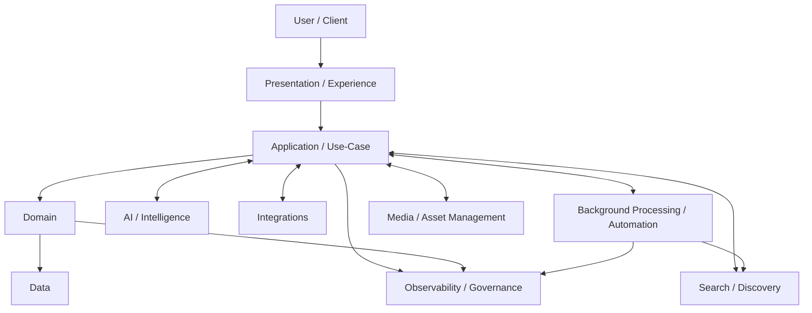

# System Architecture

## 1. Document Information

| Field                        | Value                                                                                                                                              |
| ---------------------------- | -------------------------------------------------------------------------------------------------------------------------------------------------- |
| Document ID                  | ARC-001                                                                                                                                            |
| Title                        | System Architecture                                                                                                                                |
| Project                      | eStudent.pk — Institutes & Education Directory                                                                                                     |
| Status                       | Approved architecture foundation                                                                                                                   |
| Documentation language       | English                                                                                                                                            |
| Permanent public module root | <https://estudent.pk/institutes/>                                                                                                                  |
| Governing documents          | [FND-001 Master Project Index](../00-foundation/MASTER_PROJECT_INDEX.md); [FND-002 Project Constitution](../00-foundation/PROJECT_CONSTITUTION.md) |
| Last updated                 | 2026-09-07                                                                                                                                         |

This document defines high-level, technology-neutral architectural boundaries for a system intended to remain understandable, maintainable, and evolvable for 20 or more years. It is governed by the Project Constitution and does not approve implementation technologies, schemas, interfaces, or user-interface designs.

## 2. Architecture Purpose

The architecture protects the long-term meaning, trustworthiness, discoverability, and continuity of the eStudent.pk Institutes & Education Directory. It establishes stable responsibilities and dependency rules so that implementation choices can change without unnecessarily changing public information, core domain meaning, or public URLs.

## 3. Architectural Goals

- Keep the Institutes & Education Directory as the primary initial domain while allowing future education services to be added through governed boundaries.
- Preserve accurate, attributable, verifiable, and correctable institutional information.
- Support public discovery, comparison, editorial information, controlled contributions, and future approved platform capabilities.
- Keep public information available and understandable under partial service failure.
- Enable technology replacement, future integrations, API consumers, and mobile applications without redesigning the core domain model.
- Make security, privacy, accessibility, performance, auditability, and maintainability architectural concerns from the outset.

## 4. Architectural Constraints

- The stable permanent public root is `https://estudent.pk/institutes/`; changes require the formal governance, compatibility, and migration process.
- This document is technology-neutral and does not select a programming language, framework, database, hosting provider, AI provider, search product, or third-party service.
- No application implementation, database schema, API contract, UI architecture, detailed SEO design, or deployment design is approved here.
- Institutional facts, user contributions, external-source claims, and AI-produced material must remain distinguishable.
- Detailed implementation boundaries may be approved only by later specifications and durable decisions where appropriate.

## 5. Long-Term Architecture Principles

- Prefer explicit, understandable, replaceable boundaries over hidden coupling.
- Treat public URLs, identifiers, data meaning, provenance, and history as durable assets.
- Keep domain logic independent of presentation and external vendors.
- Design capabilities to fail independently where practical and preserve critical public information.
- Make ownership, authorization, verification, freshness, correction, and audit needs explicit before implementation.
- Record material architectural choices and their consequences rather than relying on institutional memory.

## 6. System Boundary

The system boundary encompasses the eStudent.pk Institutes & Education Directory public module, its governed domain information, and approved supporting capabilities needed to publish, discover, maintain, and audit that information. The primary boundary is the permanent `/institutes/` public information space.

External organizations, data sources, client applications, maps, search services, analytics services, AI capabilities, and other eStudent.pk services are outside the core domain boundary unless and until a governed interface is approved. They may exchange information through controlled boundaries; they do not redefine canonical institutional facts.

## 7. High-Level Platform Layers

The following are conceptual responsibilities, not a framework, deployment topology, or folder structure:

- **Presentation / Experience Layer:** Delivers accessible public, editorial, contributor, and administrative experiences; it renders governed information and initiates approved use cases.
- **Application / Use-Case Layer:** Coordinates authorized actions, policies, workflows, and contracts between clients and domain capabilities.
- **Domain Layer:** Holds the business meaning, invariants, ownership, lifecycle rules, and relationships for institutional information and related concepts.
- **Data Layer:** Preserves canonical records, history, provenance, verification state, and derived-data lifecycle under governed ownership.
- **Integration Layer:** Isolates controlled exchange with external sources, partners, and future platform services.
- **AI / Intelligence Layer:** Provides governed assistance, analysis, enrichment, and automation without becoming the authoritative owner of core data.
- **Search / Discovery Layer:** Provides derived retrieval and discovery representations while preserving canonical domain ownership elsewhere.
- **Background Processing / Automation Layer:** Runs non-interactive, repeatable, observable work such as ingestion, verification support, indexing, media processing, and notifications.
- **Observability / Governance Layer:** Supports audit trails, monitoring, policy enforcement evidence, operational investigation, and architecture governance.

## 8. Domain Architecture

The architecture recognizes the following conceptual domains: institute or institution identity; institute locations; programs; admissions; fees; merit; scholarships; reviews; search; comparison; geographic discovery; editorial and content management; data ingestion; and verification and provenance. These concepts clarify responsibility and data meaning; they do not yet prescribe implementation modules, services, tables, APIs, or ownership roles.

Final implementation boundaries, contracts, and lifecycle details require later approved requirements, specifications, and ADRs. Cross-domain relationships must be purposeful, documented, and directional so future education services can reuse concepts without collapsing the Institutes domain into one undifferentiated model.

## 9. Institutes Domain

The Institutes domain is the primary initial domain. It governs the directory representation of legitimate educational institutions in Pakistan and the durable identity needed to connect institutional facts, locations, offerings, and published information. It must remain capable of supporting different institution categories without assuming that all categories have identical attributes or processes.

## 10. Geography and Location Domain

Geography and location are reusable domain concepts, not page-only attributes. They support addresses, administrative areas, service areas, coordinates where approved, proximity, geographic landing pages, and future education entities. Geographic discovery must consume governed location information and must not make an optional mapping or external location service a prerequisite for critical institute information.

## 11. Institutions / Organization Identity

Institution or organization identity defines the enduring subject about which information is asserted. Identity must be separate from a particular location, web presentation, external-source record, or AI interpretation. Future specifications must define identifiers, aliases, relationships, mergers, closures, corrections, and historical continuity so changes do not erase traceability.

## 12. Programs and Academic Offerings

Programs and academic offerings are reusable domain concepts that can relate to institutes and other future education entities. They must not be hard-coded as fields meaningful only to university pages. Later specifications will define program taxonomy, qualification context, availability, admission relation, and historical handling without assuming a single institution type.

## 13. Admissions Domain

Admissions represents governed information about applying, eligibility routes, schedules, requirements, and relevant institutional processes. It must retain source, verification, effective period, and update context, because admissions information may change. It may relate to institutes, locations, and programs, but it must not own their canonical identities.

## 14. Fees and Financial Information

Fees and financial information represents published charges, ranges, terms, caveats, and their applicable context. It must be attributed, time-aware, and clearly distinguished from estimates, community reports, and official information. This domain must not imply a payment service or financial transaction capability.

## 15. Merit and Eligibility Information

Merit and eligibility represents criteria, thresholds, selection information, and context relevant to an offering or admission cycle. It must preserve period, applicability, source, and verification state. Published data must not overstate certainty where facts are incomplete, historical, inferred, or subject to institutional change.

## 16. Scholarships and Financial Aid

Scholarships and financial aid is a reusable information domain for opportunities, eligibility, deadlines, sponsors, application routes, and conditions. It may connect to an institute, program, location, or broader audience while retaining its own source, lifecycle, and verification context. It does not authorize representation of an award or a funding commitment.

## 17. Reviews and User Contributions

Reviews and other user contributions are user-generated content, distinct from verified institutional information. Their submission, moderation, attribution, consent, abuse handling, visibility, correction, and retention require later approved specifications. They must never automatically overwrite or become indistinguishable from canonical institutional facts.

## 18. Search and Discovery

Search and discovery is a platform capability that consumes governed, publishable representations to help people find information. Search indexes, rankings, filters, and suggestions are derived discovery representations, not canonical sources of institutional truth. The capability must be replaceable without changing domain meaning or public URL architecture unnecessarily.

## 19. Comparison

Comparison is a consumer-facing capability that assembles compatible, contextual information from governed domains. It must disclose meaningful differences in freshness, verification, applicability, and unavailable data rather than manufacture false equivalence. Comparison does not own the facts it presents.

## 20. Nearby / Location-Based Discovery

Nearby discovery uses reusable geography and governed institute-location relationships to provide contextual discovery. It must support graceful degradation when precise location, maps, or optional external capabilities are unavailable, while preserving access to core institute information and ordinary geographic navigation.

## 21. Content and Editorial Management

Content and editorial management governs explanatory, navigational, and curated material distinct from canonical institutional data. Editorial claims must be attributable where appropriate, subject to review and correction, and must not silently transform unverified material into institutional facts. Detailed editorial workflows remain for later specification.

## 22. Data Ingestion and External Sources

External data enters through controlled ingestion processes that preserve source identity, acquisition context, timestamps, transformation history, and review status. External provider data is not automatically authoritative public data. Ingestion may support proposed changes or enrichment, but publication of authoritative information requires approved verification and ownership processes.

## 23. Data Verification and Provenance

Verification and provenance is a cross-cutting governed capability. Material public information must be capable of retaining its source, verification state, freshness, reviewer or process context where appropriate, correction route, and relevant change history. Provenance must distinguish official institutional information, verified third-party information, user submissions, editorial interpretation, and AI-assisted outputs.

## 24. SEO Architecture Direction

SEO is a governed public-information architecture concern, not merely a presentation concern. Future detailed work must preserve useful, accurate, accessible, crawlable, canonical information; prevent thin, duplicate, misleading, or unverified content; and define metadata, structured data, internal linking, indexation, and redirect policy. No detailed SEO templates or implementation mechanisms are approved by this document.

## 25. Public URL Architecture Direction

Public URLs are durable public contracts, not implementation details. The `/institutes/` root is stable, and later URL patterns must be human-understandable, canonical, evolvable, and governed for backward compatibility. Changes require impact analysis, approval, durable decision records where applicable, migration planning, redirects, and validation for human users, search systems, backlinks, and future clients.

## 26. API and Integration Boundary

APIs expose approved platform capabilities and governed contracts rather than internal storage or implementation details. Future API and integration specifications must define versioning, authentication, authorization, rate limits, lifecycle, deprecation, error behavior, and compatibility. Internal implementation changes must not unnecessarily break approved consumers.

## 27. AI Capability Boundary

AI is an assistive and intelligence layer, not an uncontrolled source of truth. It may consume appropriately permissioned and governed domain data through approved interfaces for assistance, analysis, enrichment proposals, discovery support, or automation. AI-derived material requires defined validation, provenance, safety, accountability, and review before it is presented as authoritative; AI agents and automation may not bypass core data-integrity rules.

## 28. Authentication and Identity Boundary

Authentication and identity are boundary capabilities for users, contributors, institutional representatives, reviewers, administrators, integrations, and future clients. They must support least privilege, accountable authorization, privacy-aware handling, and revocation or lifecycle needs. They do not redefine institution identity, which remains a separate domain concept.

## 29. Security Architecture Direction

Future architecture and implementation must apply secure defaults, least privilege, input and output protections, secrets handling, authorization boundaries, abuse resistance, auditability, and proportionate review. Security-sensitive changes require explicit assessment and approved implementation details; this document does not select security products or mechanisms.

## 30. Performance and Scalability Direction

The system must support controlled growth in public traffic, records, searches, media, contributors, integrations, and operational activity. Later work must establish measurable expectations and capacity, availability, recovery, and data-quality direction. Scaling must not require changing core domain meaning or abandoning stable public URLs.

## 31. Caching and Read Optimization Direction

Caching and read optimization may improve resilient public delivery, but cached data is not canonical. Derived representations need explicit freshness, invalidation, failure, and recovery direction before implementation. Stale or unavailable optional optimization must not silently alter canonical facts or make critical public institute information unavailable.

## 32. Observability and Auditability Direction

Observability and auditability must support investigation of material data changes, publication and verification actions, security-relevant events, integration behavior, failures, and release outcomes without exposing unnecessary personal data. Analytics and observability are supporting capabilities and must not become dependencies for core public data availability.

## 33. Background Jobs and Automation Direction

Background processing and automation may perform controlled asynchronous work including ingestion, revalidation support, indexing, media processing, notifications, and scheduled checks. Such work must be observable, retryable where appropriate, idempotent or otherwise safely governed, and subject to the same authorization, provenance, and integrity rules as interactive actions.

## 34. Media and Asset Management Direction

Media and assets are governed supporting resources for institute, editorial, and future content. Later specifications must define ownership, rights, attribution, validation, transformations, accessibility alternatives, lifecycle, and removal processes. Asset delivery or processing failures should degrade without removing critical textual institutional information.

## 35. Internationalization / Localization Direction

The architecture must accommodate future language, locale, script, geographic naming, date, number, and content-governance needs without making unapproved assumptions about a single audience presentation. Translation or localization must not lose source meaning, verification context, canonical identity, or URL governance. Exact language and locale requirements require later approval.

## 36. Accessibility Architecture Direction

Accessibility is a cross-cutting architectural quality. Future requirements and implementation must ensure that content, navigation, forms, media alternatives, comparison, search, and error or degraded states can be used by people with varied abilities, devices, languages, connectivity, and assistive technologies. Accessibility requirements and validation criteria require later detailed specification.

## 37. Mobile Application Readiness

Mobile applications must be able to consume approved platform capabilities through governed interfaces without requiring a redesign of the core domain model. Mobile clients are clients of domain-backed application capabilities, not alternate owners of institutional data. Their introduction must respect public URL, API, identity, privacy, compatibility, and lifecycle governance.

## 38. Future API / Platform Readiness

Future platform services may reuse governed identity, geography, programs, discovery, and provenance concepts through deliberate contracts. Expansion must preserve the Institutes & Education Directory boundary and prevent unapproved shared assumptions from coupling independent education services. Any new public platform capability requires documented requirements and appropriate decisions.

## 39. Domain Dependency Rules

- Presentation depends on application or use-case capabilities, not directly on database implementation.
- Application capabilities coordinate domain work and must not allow client presentation concerns to redefine domain invariants.
- Domain concepts must not depend on external vendors, provider-specific data models, or a particular AI capability.
- AI may consume governed domain data but must not become its authoritative owner.
- Search indexes are derived discovery representations, not the canonical source of institutional truth.
- Cached data is not the canonical source.
- External provider data is not automatically authoritative.
- User submissions are not automatically verified institutional facts.
- Analytics and observability must not become dependencies for core public data availability.
- Future mobile and API clients consume governed application capabilities.
- Cross-domain dependencies must be deliberate, directional, minimal, and documented; circular dependencies should be avoided.

## 40. Data Ownership Rules

Every canonical data concept requires an explicit owning domain and accountable stewardship defined by later specifications. The owner governs meaning, validation, lifecycle, publication eligibility, correction handling, and change history; other domains consume it through governed relationships or representations. Derived indexes, caches, analytics, exports, AI outputs, and external copies do not acquire canonical ownership merely by storing or presenting data.

## 41. Failure and Degradation Principles

Critical public institute information must not become unavailable merely because an AI, search, map, analytics, media-processing, or external integration service is unavailable. Optional capabilities should fail independently, communicate meaningful degraded states where needed, and recover without corrupting canonical data. The system must prefer trustworthy partial information over misleading substitutes, invented results, or silent loss of provenance.

## 42. Backward Compatibility

Backward compatibility is preferred wherever practical for public URLs, identifiers, published information meaning, approved contracts, and integrations. Breaking changes require explicit rationale, impact analysis, approval, deprecation and communication direction, migration planning, and validation. Compatibility decisions must preserve historical traceability rather than silently replacing old behavior or records.

## 43. Migration and Evolution Strategy

Changes must be incremental, documented, testable, and reversible where practical. Data meaning, provenance, verification state, identifiers, and public information routes need explicit migration and compatibility handling. Replacement of an implementation technology, provider, or derived representation must preserve canonical domain information and public URL architecture unless an approved change explicitly establishes otherwise.

### Architecture Evolution

This document defines stable principles and boundaries, while detailed implementation choices will be documented later. Technology choices may evolve, but domain meaning and public URL stability should survive those changes. Major changes require applicable ADR, RFC, and change-management processes, and historical architectural decisions must remain traceable.

## 44. Architecture Governance

Architecture changes must follow the Project Constitution. Maintainers must assess affected boundaries, ownership, dependencies, security, privacy, accessibility, performance, observability, compatibility, migration, and documentation before approving material change. Requirements, assumptions, options, decisions, and future ideas must remain clearly distinguished.

## 45. Architecture Decision Records

Major durable architecture decisions must be recorded as `ADR-xxx` documents. Each ADR must state context, decision, status, rationale, alternatives, consequences, affected documents, and supersession information where applicable. Significant proposals should be developed through the governed RFC process before approval. ADRs preserve historical traceability and must not be silently rewritten to hide earlier decisions.

## 46. Current Architecture Status

This is the approved high-level architecture foundation. It approves the technology-neutral principles and conceptual boundaries in this document only. Implementation architecture, database schema, API contracts, detailed SEO architecture, UI architecture, deployment architecture, and technology selection are **not** approved by this document.

## 47. Future Architecture Areas

Later approved documents may define detailed domain specifications; data modeling and lifecycle rules; public URL patterns; SEO architecture; API contracts; identity and authorization; security and privacy controls; search behavior; AI governance; editorial workflows; ingestion and verification operations; accessibility; mobile clients; performance, resilience, and recovery; observability; media; and implementation or deployment architecture. Such work must remain consistent with this document and the Project Constitution, or formally amend them through governed change.
