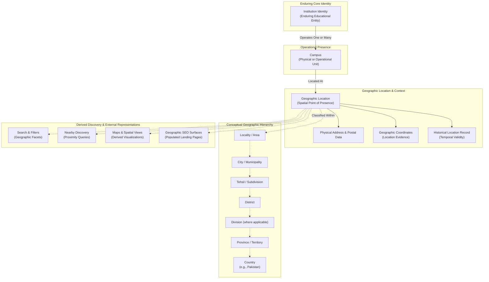

# Institutes Directory — Geography and Location Specification

## 1. Document Information

| Field | Value |
| --- | --- |
| Document ID | MOD-005 |
| Title | Institutes Directory — Geography and Location Specification |
| Project | eStudent.pk — Institutes & Education Directory |
| Status | Approved module specification |
| Scope | Technology-neutral conceptual geography and location model |
| Documentation language | English |
| Default branch | `main` |
| Last updated | 2026-09-08 |

This document establishes conceptual geography and location principles only. It approves no database schema, SQL DDL, tables, columns, GIS software, spatial database extensions, geocoding engines, map libraries, API contracts, routing syntax, or technology stack selections.

## 2. Purpose

MOD-005 defines the technology-neutral conceptual geography and location model for the eStudent.pk Institutes & Education Directory. It provides a durable geographic foundation designed to remain accurate, understandable, and extensible across 20+ years of administrative reorganization, urban growth, and discovery evolution.

Geography provides reusable spatial and administrative context. Geography describes where educational entities operate, but geography must never define, alter, or replace Institution Identity.

The specification establishes a strict separation between geography and:
- Institution Identity
- Institution Type
- Institution Status
- Campus
- Program
- Program Offering
- Taxonomy
- Search
- Filters
- Rankings
- SEO representations
- AI-derived representations

## 3. Scope

The scope of this specification encompasses:

- Technology-neutral geography principles and multi-tiered conceptual administrative hierarchy.
- The fundamental independence of Institution Identity and Campus concepts from geographic place.
- Conceptual representations of Country, Province/Territory, Division, District, Tehsil/Subdivision, City/Municipality, and Locality/Area.
- Distinct modeling of physical addresses, postal codes, and empirical geographic coordinates.
- Multi-campus institutions, dispersed campuses, campus relocations, and historical locations.
- Administrative boundary shifts, historical geography preservation, and geographic naming/alias governance.
- Handling ambiguous, unknown, disputed, and conflicting geographic data.
- Geographic source authority, evidence evaluation, and editorial verification under MOD-003.
- The boundary between canonical geographic data and derived discovery representations (search facets, nearby proximity queries, map views, and geographic SEO surfaces).
- Geographic URL principles, internal linking structures, quality dimensions, and international extensibility.

This specification does not approve:
- Database schemas, spatial indexes, tables, foreign keys, or SQL migration scripts.
- Specific database engines, GIS libraries, or geospatial data stores.
- Map rendering providers, mapping SDKs, or geocoding APIs.
- Search indexing software, spatial search algorithms, or radius calculation formulas.
- Frontend map widgets, autocomplete address inputs, or UI layouts.
- Routing implementation code or framework-specific URL handlers.
- Automated scraping tools or location extraction pipelines.

## 4. Governing Documents

This document is governed by and must be read consistently with the approved foundation and architecture baselines:

- [FND-001: Master Project Index](../00-foundation/MASTER_PROJECT_INDEX.md) — Establishes project identity, vision, documentation hierarchy, and the permanent public module root `<https://estudent.pk/institutes/>`.
- [FND-002: Project Constitution](../00-foundation/PROJECT_CONSTITUTION.md) — Establishes durable project governance, the documentation-first rule, data integrity principles, and change management processes.
- [ARC-001: System Architecture](../01-architecture/SYSTEM_ARCHITECTURE.md) — Establishes technology-neutral architectural layers, modular boundaries, and quality concerns.
- [ARC-002: Domain Model and Bounded Contexts](../01-architecture/DOMAIN_MODEL_AND_BOUNDED_CONTEXTS.md) — Defines bounded domain contexts, explicitly establishing the separate **Campus and Location Context** and **Geography Context**.
- [ARC-003: Data Architecture and Lifecycle](../01-architecture/DATA_ARCHITECTURE_AND_LIFECYCLE.md) — Defines data governance, provenance, verification, temporal validity, and the lifecycle of governed information.
- [MOD-001: Institutes Directory Requirements](INSTITUTES_DIRECTORY_REQUIREMENTS.md) — Establishes functional and quality requirements for the directory module.
- [MOD-002: Institutes Directory Information Architecture and URLs](INSTITUTES_DIRECTORY_INFORMATION_ARCHITECTURE_AND_URLS.md) — Establishes public information architecture, canonical entity URLs, geographic navigation concepts, and discovery representations.
- [MOD-003: Institutes Directory Information Specification and Content Governance](INSTITUTES_DIRECTORY_INFORMATION_SPECIFICATION.md) — Establishes information meaning, source authority, verification, freshness, physical address/coordinate evidence, and canonical-versus-derived boundaries.
- [MOD-004: Institutes Directory Taxonomy and Classification Specification](INSTITUTES_DIRECTORY_TAXONOMY_AND_CLASSIFICATION.md) — Establishes multi-dimensional taxonomy principles and strictly separates educational taxonomy from geographic place (MOD-TAX-027).

MOD-005 defines the geography and location principles that govern geographic data and relationships within the directory without amending or overriding any governing document.

## 5. Geography Principles

**MOD-GEO-001 — Geography as independent descriptive context.** Geography is reusable domain knowledge that exists independently of educational organizations. Geographic entities (countries, provinces, districts, cities, localities) provide spatial and administrative context to institutions and campuses. Geography describes where an institution operates; it does not constitute or constrain the institution's identity.

**MOD-GEO-002 — Durable and flexible hierarchy.** Real-world administrative structures evolve over decades through redistricting, renaming, administrative splits, and municipal expansions. The conceptual geographic model must accommodate hierarchy reorganizations without corrupting historical records, breaking entity identity, or forcing incomplete data into artificial administrative levels.

**MOD-GEO-003 — Honest provenance and temporal awareness.** Geographic assertions (such as a campus address, municipal boundary, or coordinate point) are factual claims requiring source attribution, evidence, and temporal boundaries under MOD-003 and ARC-003. When geographic definitions change, historical associations must remain preserved and interpretable.

## 6. Geography versus Institution Identity

**MOD-GEO-004 — Independence of institution identity from geography.** An institution's enduring identity is strictly independent of its geographic location. An institution may relocate its main campus, open branch campuses in other cities, close historical sites, or operate across multiple administrative territories without altering, fragmenting, or terminating its core identity.

An institution identity must never be named, keyed, or conceptually bound to a single geographic area. For example, if an institution founded in Lahore later establishes campuses in Rawalpindi, Karachi, and Peshawar, or moves its administrative headquarters to Islamabad, it remains one coherent institution entity whose physical operational presences are modeled as distinct campuses.

The diagram demonstrates that Institution Identity operates one or more Campuses. Each Campus is situated at a Geographic Location characterized by address, coordinates, and historical records. Geographic Locations relate to the independent conceptual Geographic Hierarchy, which feeds downstream derived discovery and presentation views without redefining canonical identity.

## 7. Geography versus Institution Type and Taxonomy

**MOD-GEO-005 — Strict boundary between geography and taxonomy.** Geographic entities must never be conflated with taxonomy classifications (reaffirming MOD-TAX-027).

- "Karachi", "Faisalabad", "Sindh", and "Khyber Pakhtunkhwa" are geographic entities.
- "University", "Medical College", "Technical Institute", and "Higher Secondary School" are taxonomy categories.
- A descriptive phrase such as "Colleges in Peshawar" represents a dynamic discovery intersection (Taxonomy Filter + Geographic Filter). It is not an independent taxonomy category.
- Taxonomy categories must never contain geographic qualifiers (e.g., "Peshawar College" is an institution name or discovery query, never a taxonomy classification).

## 8. Institution Location Concept

An educational institution operates in physical space through its physical presences. At the organizational level, an institution's "location" is a conceptual aggregation of its campuses and administrative seats:

- For single-campus institutions, the institution's operational location coincides directly with that campus's location.
- For multi-campus institutions, the institution has multiple operational locations across cities, districts, or provinces. An institution may also identify a designated principal seat, registered office, or main campus.
- The directory must never force a multi-campus institution into a flat, single-location model that discards its secondary or satellite presences.

## 9. Campus Location Concept

**MOD-GEO-006 — Campus as the primary physical location anchor.** In accordance with ARC-002, a Campus is the primary organizational unit that anchors physical presence:

- Every physical campus possesses exactly one primary physical location at any given point in time.
- A campus location includes its physical address, postal zone, verified coordinates, and associated administrative geographic hierarchy (Locality, City, Tehsil, District, Division, Province, Country).
- Virtual, online, or correspondence campuses possess administrative headquarters or operational centers, but their delivery mode is classified under MOD-TAX-024 rather than defined by geography.

## 10. Geographic Hierarchy Concept

**MOD-GEO-007 — Conceptual and extensible geographic hierarchy.** The directory organizes geographic knowledge through a multi-level conceptual hierarchy:

$$\text{Country} \rightarrow \text{Province / Territory} \rightarrow \text{Division} \rightarrow \text{District} \rightarrow \text{Tehsil / Subdivision} \rightarrow \text{City / Municipality} \rightarrow \text{Locality / Area}$$

This hierarchy is conceptual and flexible:
1. **Not every entity requires every level:** An institution in a federal territory or cantonment may bypass division or tehsil tiers if administrative structures omit them.
2. **Levels describe relationships, not immutable schemas:** The hierarchy supports regional differences and administrative variations across jurisdictions.
3. **Extensibility:** The model allows new tiers (such as union councils, postal sectors, or metropolitan development authorities) to be accommodated without restructuring the core architecture.

## 11. Country Concept

The Country tier represents sovereign national jurisdictions. The initial operational focus of the directory is Pakistan. However, the conceptual architecture must remain internationally extensible:
- Country entities possess standardized names, international ISO codes, and default administrative sub-level structures.
- Future cross-border educational partnerships, overseas campuses of domestic universities, or directory expansion into other countries must integrate seamlessly by instantiating new Country nodes without breaking domestic relationships.

## 12. Province and Territory Concept

The Province and Territory tier represents first-order sub-national administrative units. In the initial Pakistan context, this includes:
- The four provinces: Punjab, Sindh, Khyber Pakhtunkhwa, Balochistan.
- Federal and special administrative territories: Islamabad Capital Territory (ICT), Gilgit-Baltistan (GB), Azad Jammu and Kashmir (AJK).

The model treats these entities objectively based on verified civil administrative structures without making political, constitutional, or legal assertions.

## 13. Division Concept

The Division tier represents an administrative grouping of contiguous districts supervised by a commissioner. Divisions exist in several provinces of Pakistan (e.g., Lahore Division, Karachi Division, Malakand Division).
- Divisions serve as regional aggregation contexts between provinces and districts.
- Because divisions have historically been abolished, reinstated, and reorganized across different regimes and provinces, the Division tier is modeled as an optional, subordinate grouping that can be present or omitted based on provincial administrative validity.

## 14. District Concept

The District tier represents the primary local civil, revenue, and educational administration unit in Pakistan.
- Districts are highly significant for educational governance, as educational boards (BISE), district education authorities, and statutory quotas operate at the district level.
- District boundaries frequently undergo government-mandated splits, mergers, or reclassifications (e.g., carving new districts out of existing ones).
- The directory must accommodate newly established districts and maintain historical mapping to predecessor districts.

## 15. Tehsil and Subdivision Concept

The Tehsil (or Taluka / Sub-division) tier represents sub-district local administrative units.
- Tehsils are vital for rural, agricultural, and peri-urban educational discovery, distinguishing institutes located outside primary metropolitan centers.
- Tehsil associations must be populated where verified evidence exists, but must remain optional so that absence of tehsil data does not invalidate a campus record.

## 16. City and Municipality Concept

The City and Municipality tier represents recognizable urban settlements, metropolitan areas, towns, and municipal corporations.
- Cities form the primary mental model for public student navigation (e.g., "Colleges in Lahore", "Universities in Sukkur", "Schools in Abbottabad").
- Cities are conceptually distinct from revenue districts: a major metropolitan city may span multiple administrative districts (e.g., Karachi comprising multiple districts), while a single district may encompass several distinct cities and towns.
- The model must support multiple cities within a district and poly-district metropolitan configurations.

## 17. Locality and Area Concept

The Locality and Area tier represents granular urban and suburban neighborhoods, commercial districts, cantonment zones, residential sectors, or housing development phases (e.g., Gulberg, F-7, Clifton, Saddar, DHA Phase 6, Hayatabad, Satellite Town).
- Localities provide essential intra-city orientation, particularly in large metropolitan centers where proximity within a city is a decisive enrollment factor.
- Locality boundaries are frequently informal or evolving; the directory must treat localities as descriptive sub-city areas with documented aliases and parent city relationships.

## 18. Rural and Urban Context

Educational accessibility differs significantly between urban centers and rural areas. The geography model conceptually accommodates rural and urban context:
- **Urban Context:** Institutions located within designated municipal corporations, municipal committees, cantonments, or metropolitan authorities.
- **Rural Context:** Institutions located in rural union councils, villages (dehs, mouzas, chaks), or remote valleys.
- This context allows educational researchers and students to evaluate geographical access without confusing rural locations with nearby metropolitan centers.

## 19. Address and Postal Information

**MOD-GEO-008 — Distinct address and postal concepts.** Physical addresses and postal codes are distinct descriptive attributes that must not be conflated with high-level geographic classifications:

1. **Descriptive Physical Address:** The human-readable physical routing instructions (building name, plot/house number, street/road name, sector, landmark).
2. **Postal Code / ZIP Code:** The numeric or alphanumeric postal delivery zone assigned by national postal authorities (e.g., Pakistan Post).
3. **Postal Address vs. Physical Site:** The directory must support cases where an institution's official mailing address (e.g., a GPO Box or central administrative office) differs from the physical site of its teaching campus.

## 20. Geographic Coordinates Concept

**MOD-GEO-009 — Coordinates as empirical location evidence.** Geographic coordinates (latitude and longitude) represent spatial point measurements, not entity identities:

- **Empirical Evidence:** Coordinates represent empirical evidence of where a campus entrance, administrative block, or boundary point exists on earth.
- **Precision and Uncertainty:** The model must support varying degrees of coordinate precision (e.g., rooftop-verified precision versus approximate neighborhood-centroid or city-centroid coordinates).
- **Verification and Provenance:** Coordinates must record their verification status and source (e.g., field survey, institutional disclosure, satellite verification, or unverified estimation).
- **Safety and Privacy Considerations:** In sensitive cases (e.g., specialized facilities, shelters, or security-sensitive residential schools), exact coordinates may be suppressed or generalized to preserve physical security under editorial policy.

## 21. Multiple Locations and Multi-Campus Institutions

**MOD-GEO-010 — Multi-location and multi-campus architecture.** The directory must naturally represent institutions with dispersed, multiple, or national presences:

$$\text{Institution} \xrightarrow{\text{operates}} \left\{ \text{Campus}_1, \text{Campus}_2, \dots, \text{Campus}_n \right\}$$
$$\text{Campus}_i \xrightarrow{\text{located at}} \text{Geographic Location}_i$$

- A federal university may operate a principal campus in Islamabad and independent regional campuses in Lahore, Karachi, Quetta, and Gilgit.
- Each campus possesses its own distinct geographic hierarchy, physical address, and coordinates.
- Program offerings must be associated with the specific campus where instruction is delivered (reaffirming ARC-002 and MOD-003).

## 22. Relocation and Historical Locations

**MOD-GEO-011 — Campus relocation and temporal tracking.** Educational institutions frequently move from temporary facilities to purpose-built permanent campuses:

- When a campus moves, its historical location must be preserved as a historical location fact with effective start and end dates.
- Relocation updates the campus's active location; it does not destroy its identity or create a new campus entity unless an entirely new independent branch was established.
- Public directory views present the current active location, while internal records and historical queries preserve previous locations to maintain auditability and research accuracy.

## 23. Geographic Boundary Changes

Civil administrative boundaries are not static over 20-year horizons. National and provincial governments periodically:
- Carve new districts out of existing ones (e.g., creating Murree District from Rawalpindi District, or Talagang District from Chakwal District).
- Reorganize tehsils, shift sub-district jurisdictions, or alter division boundaries.
- Expand municipal boundaries to incorporate formerly rural localities.

The geography model must handle boundary evolutions by maintaining temporal validity for administrative parent-child relationships, ensuring that historical records remain consistent with the administrative reality of their era.

## 24. Historical Geography Preservation

**MOD-GEO-012 — Historical geography continuity.** Historical institutions frequently possess historical geographic context that has been altered by time or administrative reform:

- Historical names of cities and districts (e.g., Lyallpur $\rightarrow$ Faisalabad, Montgomery $\rightarrow$ Sahiwal, Fort Sandeman $\rightarrow$ Zhob, Campbellpur $\rightarrow$ Attock) must be preserved in historical records.
- Historical administrative affiliations (e.g., an institution founded when its location was part of a larger undivided district) must remain interpretable.
- The directory must record both the contemporary administrative context and historical designations with appropriate temporal scope.

## 25. Geographic Naming and Aliases

**MOD-GEO-013 — Geographic naming, aliases, and transliterations.** Geographic entities frequently have multiple legitimate names:

- **Official Names:** The formal statutory name designated in government gazettes.
- **Common Names / Vernacular Designations:** Widely understood colloquial names (e.g., "Pindi" for Rawalpindi, "Isloo" / "Islamabad Capital").
- **Historical Names:** Pre-rename designations preserved for search and historical continuity.
- **Transliteration Variants:** Differing English spelling variants of Urdu/regional toponyms (e.g., Dera Ghazi Khan / D.G. Khan; Khairpur Mirs / Khairpur; Nowshera / Naushahra; Charsadda / Charsada).
- **Urdu and Regional Language Scripts:** Canonical Urdu and local language representations.

Aliases map to the unified conceptual geographic entity and enrich search discoverability without generating redundant canonical entities.

## 26. Ambiguous and Unknown Geography

**MOD-GEO-014 — Representation of geographic uncertainty.** When geographic evidence is incomplete, the directory must honestly reflect uncertainty rather than force inaccurate assumptions:

- **Unknown:** No verified geographic data has been established.
- **Partially Specified:** Higher-level geography is known with certainty, but granular data is missing (e.g., District = Swat, City = Mingora, but exact street address is unrecorded).
- **Under Review:** Geographic data has been collected but awaits editorial verification.
- **Ambiguous:** Multiple conflicting locations exist without conclusive resolution.
- **Disputed:** Administrative jurisdiction or municipal boundary is subject to official or legal dispute.

The system permits partial hierarchy specification, anchoring an entity at the lowest verified tier without guessing missing lower tiers.

## 27. Conflicting Geographic Sources

When diverse sources assert divergent geographic details (e.g., an institution's prospectus lists one address, a regulatory council directory lists another, and mapping software shows a third):
- The conflict must be logged with source attribution and timestamps.
- Official statutory gazettes, survey records, and official regulatory registers take precedence over marketing literature.
- Editorial review must resolve conflicts using recent evidence, postal verification, or direct physical confirmation.

## 28. Geographic Source Authority and Verification

**MOD-GEO-015 — Geographic source authority and evidence.** Geographic assertions must be governed under the source, evidence, and verification standards of MOD-003:

- **Primary Statutory Authorities:** Survey of Pakistan, National/Provincial Disaster Management Authorities, provincial revenue departments, government gazettes, Pakistan Post official postal codes.
- **Secondary Authorities:** Educational boards (BISE), higher education commissions, university affiliation inspection reports.
- **Tertiary Sources:** Institution self-reported prospectuses, contact pages, and verified digital mapping layers.
- Every verified geographic assignment must record its supporting evidence and verification timestamp.

## 29. Geography versus Search and Filters

**MOD-GEO-016 — Geography in search and filtering.** Geographic entities provide standardized faceted values for search and discovery interfaces:

- A search filter allows selecting `Province = Sindh` AND `City = Hyderabad` AND `Type = University`.
- The search query resolves against canonical institution and campus locations.
- Search filters are runtime discovery mechanisms governed by MOD-002; they do not alter canonical geographic data.

## 30. Geography versus Nearby Discovery

**MOD-GEO-017 — Derived proximity and nearby discovery.** "Nearby" discovery allows users to find educational institutions relative to a reference location:

- Nearby discovery is an ephemeral, computed discovery query.
- It operates using governed campus coordinates, spatial proximity, administrative adjacency, or locality clustering.
- Proximity queries are derived outputs; they do not create permanent static attributes on institution records.
- The directory approves no specific distance algorithm, radius limit, or spatial library at this baseline stage.

## 31. Geography versus Maps and Spatial Representations

**MOD-GEO-018 — Maps as derived spatial projections.** Digital maps, interactive map pins, boundary polygons, and spatial visualizations are derived presentation layers:

- A map is a visual projection of verified underlying campus location data.
- Maps are consumers of governed data, never independent authorities or competing sources of truth.
- The directory remains completely provider-agnostic, approving no specific mapping service, tile provider, or client-side mapping library.

## 32. Geography versus SEO Landing Pages

**MOD-GEO-019 — Controlled geographic SEO surfaces.** Geographic landing pages can provide useful public discovery, but they must be strictly governed to prevent mass generation of low-value, thin-content pages:

- **Crawlability and Value:** Public geographic landing pages (e.g., "Institutes in Gujranwala") are derived discovery surfaces that must satisfy substance and utility criteria under MOD-002.
- **Threshold for Indexation:** Geographic indexation requires meaningful institution density. Sparsely populated combinations (e.g., niche taxonomy categories in small localities) must not generate indexed pages, using canonicalization or noindex directives where appropriate.
- **Non-Duplication:** A single institution operating in a city must not be duplicated into thousands of programmatic locality pages without distinct educational value.

## 33. Geographic URL Relationship

**MOD-GEO-020 — URL decoupling and alignment with MOD-002.** In strict compliance with MOD-002:

- The permanent public module root remains `<https://estudent.pk/institutes/>`.
- Canonical institution URLs are anchored directly under the module root (e.g., `/institutes/{institution-slug}/`), independent of geography.
- An institution operating campuses across five cities maintains exactly one canonical institution profile URL. It does not possess multiple conflicting canonical URLs.
- Geographic navigation URLs (e.g., `/institutes/punjab/`, `/institutes/lahore/`) are collection and discovery surfaces that link to canonical institution profiles.
- No final implementation routing syntax or URL pattern is approved by this document beyond the principles established in MOD-002.

## 34. Geographic Indexing and Discoverability

The directory distinguishes four conceptual geographic constructs:
1. **Geographic Master Data:** Internal normalized knowledge of administrative areas, boundaries, and aliases.
2. **Geographic Navigation Facets:** Runtime UI filters allowing users to narrow search results.
3. **Geographic Landing Surfaces:** Governed, public, indexable pages for populated administrative regions.
4. **Canonical Entity URLs:** Permanent public profiles representing enduring institutions and campuses.

Keeping these constructs distinct prevents search index bloating and ensures search engines discover high-quality, non-redundant pages.

## 35. Geographic Internal Linking

Geographic internal linking structures connect the directory coherently:
- **Hierarchical Vertical Linking:** Country $\rightarrow$ Province $\rightarrow$ District $\rightarrow$ City $\rightarrow$ Campus $\rightarrow$ Programs.
- **Breadcrumb Paths:** Contextual breadcrumbs that communicate spatial belonging without asserting exclusive ownership.
- **Lateral Regional Links:** Links connecting neighboring cities or adjacent districts within a division to assist regional exploration.
- **Campus-to-City Connections:** Canonical campus entries link to their respective city and district discovery hubs, providing bidirectional navigation.

## 36. Geographic Data Quality Requirements

**MOD-GEO-021 — Geographic quality dimensions.** Geographic data must be maintained against eleven rigorous quality dimensions:

1. **Spatial Accuracy:** Coordinates and physical addresses accurately match real-world physical entrances and grounds.
2. **Hierarchy Integrity:** Child administrative units correctly relate to their verified parent units.
3. **Temporal Validity:** Locations and boundary associations reflect active validity periods and preserve historical transitions.
4. **Source Provenance:** Every geographic fact is attributed to verifiable sources and inspection records.
5. **Naming Completeness:** Official names, vernacular aliases, historical titles, and Urdu transliterations are recorded.
6. **Non-Duplication:** Redundant geographic nodes are merged under canonical entities with documented aliases.
7. **Resolution of Ambiguity:** Ambiguous, disputed, or borderline locations are explicitly tagged rather than masked.
8. **Multi-Campus Completeness:** All verified operational campuses of an institution are represented without omission.
9. **Granularity Awareness:** Partial location knowledge is accurately identified without speculative lower-tier data.
10. **Discoverability Usefulness:** Geographic groupings provide meaningful utility to students, parents, and researchers.
11. **Resistance to Fragmentation:** The system avoids proliferating unverified micro-localities that hinder search clarity.

## 37. Geographic Governance and Editorial Review

Geographic master data and campus location assignments are subject to editorial review:
- Creating, modifying, merging, or renaming geographic hierarchy entities requires editorial review.
- Automated geocoding outputs, web scraping data, contributor suggestions, and third-party map APIs are treated strictly as unverified proposals until verified against authoritative sources.
- Editorial adjustments to municipal boundaries or district mappings must be documented with rationale and official gazette references.

## 38. Geographic Extensibility and Future Regions

**MOD-GEO-022 — Future regional and spatial extensibility.** The geography model is architected for long-term expansion:

- **International Scope:** Integration of new countries, foreign university branches, and trans-national educational corridors without architectural alterations.
- **Specialized Spatial Zones:** Future support for special educational zones, knowledge parks, university towns, cantonment boards, and industrial training corridors.
- **Accessibility and Transit Context:** Potential future association with transit routes, public transportation access points, and student commuter catchment areas.
- **Spatial Analytics:** Reusable geographic foundations capable of supporting future demographic research, literacy mapping, and educational infrastructure planning.

These capabilities represent future conceptual possibilities and do not constitute approved current implementation scope.

## 39. Current Status

**Approved by MOD-005:**
- The technology-neutral conceptual geography and location model defined in this document.
- The conceptual geographic hierarchy (Country, Province/Territory, Division, District, Tehsil/Subdivision, City/Municipality, Locality/Area).
- The fundamental independence of Institution Identity from geographic location.
- Multi-campus relationships, campus relocations, and historical geography preservation principles.
- Distinct modeling of addresses, postal codes, and coordinates.
- Geographic naming, alias management, source authority, and editorial verification principles.
- The separation between canonical geographic data and derived discovery representations (search, filters, nearby proximity, maps, and SEO pages).
- Geographic data quality dimensions and long-term extensibility protocols.

**Not approved by MOD-005 / Unapproved implementation scope:**
- Database schemas, SQL DDL, tables, columns, constraints, foreign keys, or database migration scripts.
- GIS database extensions (e.g., PostGIS, spatial indexes) or spatial storage engines.
- Specific programming languages, frameworks, or runtime environments.
- API endpoints, request/response formats, DTOs, or JSON payloads for location data.
- Routing implementation code, URL rewrite rules, or framework-specific route patterns.
- Map rendering providers, mapping libraries (e.g., Leaflet, Mapbox, Google Maps), or geocoding services.
- Search engine implementations, geospatial index configurations, or distance calculation algorithms.
- Frontend UI components, address lookup widgets, or map view components.
- Automated web scraping scripts, data crawling pipelines, or third-party data synchronization software.
- Cloud hosting, server infrastructure, or deployment architecture.

## 40. Future Evolution Areas

Future geography and location work requiring separate documentation, specification, and formal approval includes:

1. **Geographic Master Data Catalog:** Comprehensive compilation of official administrative divisions, districts, tehsils, cities, and major localities across Pakistan, citing official census and gazette sources.
2. **Postal Code Directory Mapping:** Formalized association of national postal codes with corresponding administrative districts, cities, and localities.
3. **Physical Schema and Storage Specifications:** Future DB-series specifications defining relational schemas, spatial datatypes, and indexing strategies for geographic data once implementation phases begin.
4. **Geocoding and Spatial Ingestion Protocols:** Governed procedures for ingesting, validating, and auditing geographic coordinates from institutional submissions and field verifications.
5. **Proximity and Spatial Query Engine Specifications:** Algorithmic and technical specifications for performing radius, bounding-box, and nearest-neighbor discovery within future search architecture.
6. **Map Integration and Visualization Guidelines:** Specifications governing privacy thresholds, tile caching, map pin clustering, and accessibility for visual map representations.
7. **Regional Language Toponymy:** Comprehensive glossaries of geographic names in Urdu, Sindhi, Pashto, Balochi, Punjabi, and other regional languages for localized discovery.
