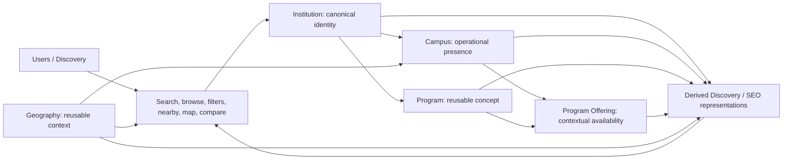

# Institutes Directory — Information Architecture and URL Specification

## 1. Document Information

| Field | Value |
| --- | --- |
| Document ID | MOD-002 |
| Title | Institutes Directory — Information Architecture and URL Specification |
| Project | eStudent.pk — Institutes & Education Directory |
| Status | Approved information-architecture and URL-principles baseline; implementation remains unapproved |
| Documentation language | English |
| Permanent public module root | <https://estudent.pk/institutes/> |
| Governing documents | [FND-001](../00-foundation/MASTER_PROJECT_INDEX.md); [FND-002](../00-foundation/PROJECT_CONSTITUTION.md); [ARC-001](../01-architecture/SYSTEM_ARCHITECTURE.md); [ARC-002](../01-architecture/DOMAIN_MODEL_AND_BOUNDED_CONTEXTS.md); [ARC-003](../01-architecture/DATA_ARCHITECTURE_AND_LIFECYCLE.md); [MOD-001](INSTITUTES_DIRECTORY_REQUIREMENTS.md) |
| Last updated | 2026-09-07 |

## 2. Purpose

MOD-002 defines the technology-neutral public information architecture and durable URL principles for the Institutes Directory. It establishes how canonical entity representations, discovery representations, geographic navigation, and derived SEO representations remain distinguishable and evolvable for 20+ years.

## 3. Scope

This specification governs public-information concepts and URL principles within the permanent <code>/institutes/</code> module. It does not approve implementation routing, a programming language, framework, database, API, frontend, search service, map provider, AI provider, hosting, or deployment approach.

## 4. Governing Documents

FND-001 establishes project identity and the permanent module root. FND-002 governs URL assets, compatibility, and change control. ARC-001 establishes public URL and SEO architecture direction. ARC-002 establishes separate Institution, Campus, Geography, Program, Program Offering, and Search and Discovery contexts. ARC-003 governs canonical identity, lifecycle, lineage, and derived representations. MOD-001 establishes module outcomes and requirements. This document must be read consistently with all six documents; it does not amend them.

## 5. Information Architecture Principles

The architecture must prioritize stable identity, clear user orientation, useful discovery, provenance-aware publication, accessibility, controlled expansion, and meaningful internal relationships. It must separate canonical entity representations from derived discovery and SEO representations, and must not turn a URL into evidence of truth, verification, or completeness.

## 6. Public Module Root

<code>https://estudent.pk/institutes/</code> is the permanent public module root. <code>/institutes/</code> is a stable public contract, not a temporary naming choice, and must be preserved across future implementation or platform changes.

## 7. Canonical URL Principles

Each publishable canonical entity representation must have no more than one canonical public URL for its identity within this module. Canonical URLs must be stable, shareable, human-readable, independent of transient discovery state, and governed separately from source records, aliases, search results, map views, rankings, analytics, and AI output.

## 8. URL Naming Principles

Public paths must use lowercase, readable words and deliberate hierarchy. They must avoid implementation details, session identifiers, tracking parameters, opaque internal identifiers where a stable descriptive form is practical, unnecessary dates, keyword stuffing, and unstable ranking numbers. A concise stable name is preferred to a promotional or over-specified path.

## 9. Slug Rules

A slug is a public, URL-safe representation of a governed name or label, not the canonical identity itself. Slugs must be lowercase, descriptive, normalized consistently, and disambiguated only when necessary for uniqueness or clarity. Slug allocation, reserved words, transliteration, punctuation, aliases, collisions, and exceptional historical forms require later governance detail; a slug change must not silently break a published URL.

## 10. Institution URL Architecture

The canonical public representation of an Institution must remain anchored directly beneath the module root: <code>/institutes/{institution-slug}</code>. This URL represents the enduring Institution identity—not a Campus, Program, Program Offering, location, type filter, source record, ranking position, or discovery query—and is the sole canonical institution URL regardless of how a visitor found it.

## 11. Institution Type Architecture

Institution type is classification and a discovery/navigation dimension, not a replacement identity. Type collections may use stable conceptual paths such as <code>/institutes/universities/</code>, <code>/institutes/colleges/</code>, <code>/institutes/schools/</code>, and <code>/institutes/technical/</code>; they must link to canonical Institution URLs and must not create duplicate canonical Institution identities.

## 12. University URL Architecture

<code>/institutes/universities/</code> is the conceptual public collection for institutions classified as universities or degree-awarding institutions where applicable. It is a navigational and potentially derived SEO representation, not an assertion that every institution has the same legal, recognition, or program characteristics.

## 13. College URL Architecture

<code>/institutes/colleges/</code> is the conceptual public collection for college-classified institutions. It must remain a classification discovery surface and must not absorb campus, affiliation, program, recognition, or location facts into the category path.

## 14. School URL Architecture

<code>/institutes/schools/</code> is the conceptual public collection for school-classified institutions. It must allow differing school forms and incomplete classification knowledge without changing the canonical Institution identity or implying universal coverage.

## 15. Technical/Vocational/Training URL Architecture

<code>/institutes/technical/</code> is the conceptual public collection for technical, vocational, training, professional, or related institutions where governed classification supports inclusion. Later approved taxonomy work may add useful sub-navigation without breaking this root path or treating a category label as an institution identity.

## 16. Other Legitimate Institution Categories

Other legitimate categories, including academies or future education entities, may receive governed collection representations only after their terminology, inclusion, quality, and usefulness are approved. New categories must extend the architecture without renaming, relocating, or duplicating existing canonical Institution URLs.

## 17. Campus Information Architecture

Campus is a separately governed operational presence of an Institution. A campus must be discoverable in its institutional context, conceptually through <code>/institutes/{institution-slug}/campuses/</code>, while a future detailed specification determines whether and how individually addressable campus pages are required. Campus URLs must never imply that every campus fact applies to the Institution overall.

## 18. Program Information Architecture

A Program is a reusable academic concept, distinct from an Institution and a Campus. An Institution-context program navigation surface may be represented conceptually by <code>/institutes/{institution-slug}/programs/</code>; this is not a claim that a Program is offered at every campus or at every time.

## 19. Program Offering Information Architecture

A Program Offering is the contextual availability relationship between a Program and an Institution or Campus, with applicable period and academic or delivery context. It must not be collapsed into a Program or institution URL. Any future public offering representation must preserve that contextual distinction, should be linked from relevant Institution/Campus/Program discovery, and requires later approved URL detail.

## 20. Geographic Information Architecture

Geography is reusable domain knowledge and a navigation context, not an attribute that redefines Institution identity. Geographic representations may lead users to relevant institutions and campuses, but must not substitute a geographic discovery URL for an Institution’s canonical URL or assume all hierarchy levels, precise coordinates, or complete coverage.

## 21. Province/Territory Architecture

Province/territory navigation must support Pakistan-focused geographic discovery while allowing future governed classifications and names. A conceptual geography hierarchy may begin below a dedicated geography navigation surface; its final routing syntax is intentionally deferred to later architecture work.

## 22. Division Architecture

Division navigation, where applicable and known, is subordinate reusable geography. It must retain its relation to province/territory without assuming every geography record or public page has a division, and it must not create a second canonical identity for an institution or campus.

## 23. District Architecture

District navigation may provide useful discovery and internal-linking context. It must accommodate changing boundaries, aliases, and incomplete information through governed geography rather than encoding unreviewed assumptions into permanent Institution paths.

## 24. Tehsil/Subdivision Architecture

Tehsil/subdivision navigation must remain optional and data-quality-aware. It may enrich geographic discovery when useful, but absence, ambiguity, or later administrative change must not impair access to an Institution or Campus canonical representation.

## 25. City Architecture

City navigation may support human-readable location discovery and contextual breadcrumbs. It must distinguish a city from a campus and Institution identity, accommodate local naming variation, and avoid treating a mailing address or user query as authoritative geographic classification.

## 26. Locality/Area Architecture

Locality/area is the most granular conceptual geographic context in this baseline and may be partial, approximate, or unsuitable for indexable navigation. It must be governed for privacy, safety, ambiguity, and usefulness before public geographic representation; no final locality routing syntax is approved here.

## 27. Search Information Architecture

Search is a discovery representation that resolves user intent to governed, publishable content. Search result URLs, query state, suggestions, and result ordering are not canonical Institution, Campus, Program, Program Offering, or Geography URLs. Search must lead users to canonical entities while honestly handling incomplete coverage and no-result conditions.

## 28. Filter Information Architecture

Filters narrow discovery using governed facets such as type, geography, program/discipline, or freshness context. Filter combinations are derived discovery state, not canonical entity identity. They must be bounded and useful, and must not create uncontrolled URL combinations merely because a facet exists.

## 29. Nearby Information Architecture

Nearby discovery is an optional derived relationship between user-supplied or approved location context and governed campus locations. It is not a canonical entity representation, must work conceptually without precise location access, and must not expose location context or make location collection necessary for core access.

## 30. Map Information Architecture

Map views are optional geographic discovery representations of governed campus locations. They are not authoritative sources for location facts, cannot replace non-map access, and must not make a map provider, coordinate availability, or viewport state part of an Institution’s canonical URL.

## 31. Compare Information Architecture

Comparison is a user-selected derived representation of institutions, campuses, or offerings. A comparison URL, if later approved, must express scope and limitations but is not canonical for its compared entities, must not imply an unapproved quality judgment, and is normally unsuitable as a durable SEO substitute for entity pages.

## 32. Rankings/Top-List URL Policy

Rankings and top lists are not an approved authoritative quality system. If later approved, a list must be governed by stated scope, methodology, evidence, period, limitations, and correction path. Ranking number, sorting position, or promotional status must never appear in a canonical Institution URL; list pages are indexable only when independently valuable and approved.

## 33. Pagination Architecture

Pagination is a traversal aid for bounded collections, not an entity identity or quality signal. Paginated views must preserve clear collection context, avoid canonicalizing a page of results as an Institution, and require later detailed treatment of crawlability, consolidation, and navigation behavior without selecting implementation mechanisms.

## 34. Sorting Architecture

Sorting is derived discovery state. Its basis must be understandable and must not silently present prominence, distance, completeness, recency, sponsorship, or editorial selection as quality or rank. Sorting variants are not canonical entity URLs and should be indexable only under explicitly approved, demonstrable-value policy.

## 35. Query Parameter Policy

Query parameters or equivalent state may support future discovery functions, but no parameter syntax is approved by this document. Tracking, session, personalization, transient map viewport, ungoverned filter, and sort state must not be part of canonical entity URLs. Any indexable parameterized representation requires explicit approved canonicalization and value justification.

## 36. Canonicalization and Duplicate URL Prevention

A canonical entity must resolve to one preferred public representation. Alternate spellings, legacy paths, trailing or formatting variants, discovery states, category paths, and external campaign links must be consolidated through governed canonicalization or backward-compatible redirection as appropriate. Canonicalization must never erase historical identity or conceal a material merger, split, closure, or correction.

## 37. Indexing / Noindex Conceptual Rules

Useful, substantive, publishable canonical entity pages are intended for discoverability where quality and policy permit. Search, filter, sort, nearby, map, comparison, pagination, empty, error, private, duplicate, transient, and low-value representations should normally not be indexable; a bounded derived collection may be conditionally indexable only when it has stable intent, unique value, adequate governed content, and approved policy. This is conceptual indexing policy, not a technical directive.

## 38. Breadcrumb Architecture

Breadcrumbs must communicate a user-understandable navigation hierarchy without asserting false ownership or identity. Canonical Institution breadcrumbs should preserve the module root and may include a valid discovery context, but a type or geography trail must not imply that the Institution has a second canonical URL at that trail.

## 39. Internal Linking Architecture

Internal links must connect module root, type collections, geographic navigation, canonical Institution pages, Campus context, Programs, Program Offerings, and related governed discovery pages in ways that help users and crawlers reach useful content. Links must use canonical targets where available and must avoid manufacturing relationships, overstating coverage, or amplifying thin pages.

## 40. Structured Navigation Hierarchy

The conceptual URL tree below shows approved direction, not final routing mechanics for every future representation:

    /institutes/
    ├── universities/
    ├── colleges/
    ├── schools/
    ├── technical/
    ├── {institution-slug}
    │   ├── campuses/
    │   └── programs/
    └── [governed geographic navigation — final syntax deferred]

The diagram is conceptual. Derived discovery/SEO representations consume governed publishable information and do not become canonical authorities or replace entity URLs.

## 41. URL Redirect and Migration Policy

A public URL change requires documented impact analysis, approval through the governing change process, a backward-compatible migration and redirect plan where practical, internal-link updates, canonicalization direction, historical-reference review, and post-change validation. Technology replacement alone is never sufficient reason to abandon a public URL.

## 42. Historical URL Preservation

Historical URLs are long-term public references. They must be preserved or redirected to the most truthful successor where practical, with user-visible context when a direct successor could mislead. Historical preservation must consider bookmarks, backlinks, citations, search indexes, future clients, and the distinction between an identity’s continuity and a changed fact.

## 43. Slug Changes and Rename Policy

Institutional renaming should preserve the existing canonical Institution URL where practical; a new name does not by itself require a new URL. If a governed slug change is necessary, the prior URL must remain historically resolvable through compatible handling. Aliases may support discovery but must not create competing canonical Institution URLs.

For mergers, the record must retain traceability and each predecessor URL must lead to the most accurate governed historical or successor representation without falsely equating identities. For splits, each legacy URL must preserve historical explanation and direct users only where a successor relationship is governed. For closures, the canonical historical identity should remain findable where publication policy permits, with status context rather than silent deletion. For relocations, the Institution URL remains stable; campus/location representation changes must retain relevant history. For category changes, retain the canonical Institution URL and update classification/discovery relationships without relocating the identity.

## 44. SEO and Discoverability Principles

Discoverability must be earned through stable entity URLs, useful governed content, crawlable navigation, accurate internal links, clear canonicalization, historical continuity, and transparent scope. Derived SEO representations must have lineage, freshness, correction, and quality governance, and must not cause a search engine or an AI summary to become the authority for an Institution, Campus, Program, Offering, or Geography fact.

## 45. Thin/Empty/Low-Value Page Prevention

The architecture must prevent mass generation of empty, substantially duplicate, overly narrow, unverified, stale, or boilerplate representations. A proposed public collection or derived landing page needs meaningful user intent, sufficient governed content, truthful scope, navigational value, and maintenance capacity. Missing data, zero results, and transient states do not justify indexable permanent URLs.

## 46. Internationalization / Language Expansion Readiness

The architecture must accommodate future languages, scripts, transliteration, local names, and accessible labels without changing canonical identity or destabilizing existing URLs. This baseline does not approve language-specific URL syntax, translations, locale routing, or a canonical-language policy; those require later approved work and compatibility assessment.

## 47. Future Mobile/API/AI Compatibility

Future mobile clients, APIs, integrations, and AI systems may consume governed information through later approved contracts without requiring a redesign of the core URL architecture. AI-generated summaries, recommendations, query interpretations, and derived representations must remain attributable and non-canonical unless a later explicitly governed approval establishes otherwise; they must never independently create canonical entity URLs.

## 48. URL Governance

MOD-IA-001: The permanent public root <code>https://estudent.pk/institutes/</code> must be preserved.

MOD-IA-002: Institution identity, institution type, Campus, Program, Program Offering, Geography, discovery/search representation, and derived SEO representation must remain distinct in information architecture and URL governance.

MOD-IA-003: Each canonical Institution identity must have one canonical public URL and must not be canonically represented by search, filter, category, ranking, map, compare, or tracking URLs.

MOD-IA-004: Material URL, slug, canonicalization, indexability, or migration changes require documented impact assessment, approval, compatibility direction, and validation under FND-002.

MOD-IA-005: Derived discovery, SEO, analytics, cache, and AI representations must remain governed, correctable, and non-canonical.

MOD-IA-006: New entity categories and discovery capabilities must extend, rather than destabilize, the established <code>/institutes/</code> public root and existing canonical URLs.

## 49. Current Status

MOD-002 approves information-architecture and URL principles only. It does not approve implementation routing, URL-processing mechanisms, a technology stack, database schemas, APIs, frontend components, search or map behavior, indexing implementation, structured markup, deployment, providers, or application code.

## 50. Future Evolution Areas

Later approved documentation may define detailed taxonomy and slug governance; campus, Program, and Program Offering public representations; final geographic routing syntax; search/filter/map/nearby/compare behavior; indexation and metadata policy; structured data; editorial quality thresholds; language/locale handling; redirect operations; analytics; API contracts; mobile experiences; and AI governance. Such work must preserve this document’s canonical-identity, compatibility, and technology-neutral principles or formally change them through the governing process.
