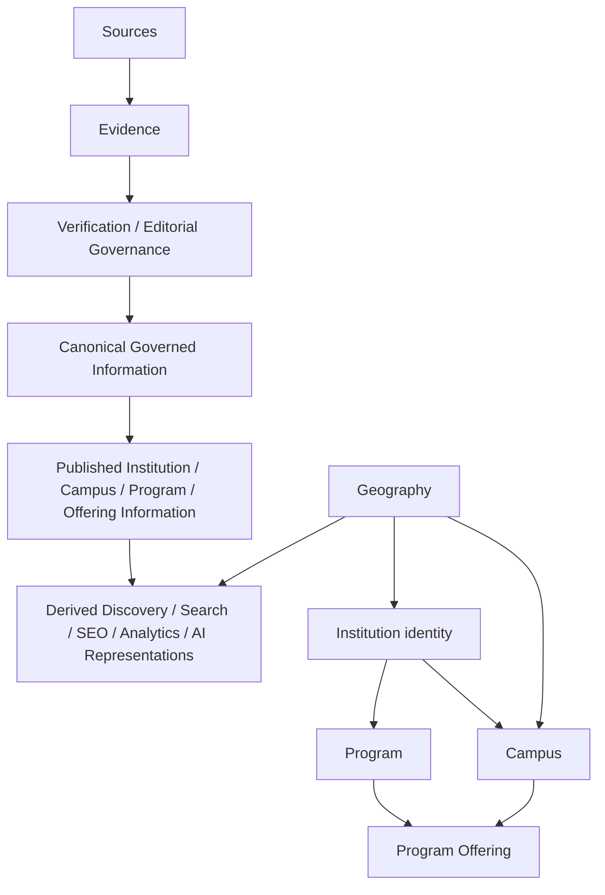

# Institutes Directory — Information Specification and Content Governance

## 1. Document Information

| Field | Value |
| --- | --- |
| Document ID | MOD-003 |
| Title | Institutes Directory — Information Specification and Content Governance |
| Project | eStudent.pk — Institutes & Education Directory |
| Status | Approved module specification |
| Scope | Technology-neutral information specification and content governance |
| Last updated | 2026-09-07 |

This document approves conceptual information meaning and governance only. It creates no implementation design.

## 2. Purpose

MOD-003 defines the information the directory may represent, how that information earns authority, and how public canonical information differs from derived representations. It is designed to remain useful for 20+ years of institutional, educational, geographic, and discovery change.

## 3. Scope

The scope covers Institutions, their classifications and lifecycle, Campuses, Programs, Program Offerings, public supporting information, Geography, Sources, Evidence, verification, temporal meaning, canonical publication, and derived discovery, SEO, and AI representations. It does not approve a database schema, API contract, application architecture, routing, technology stack, provider, scraping method, automation tool, hosting, or deployment.

## 4. Governing Documents

This document is governed by [FND-001](../00-foundation/MASTER_PROJECT_INDEX.md), [FND-002](../00-foundation/PROJECT_CONSTITUTION.md), [ARC-001](../01-architecture/SYSTEM_ARCHITECTURE.md), [ARC-002](../01-architecture/DOMAIN_MODEL_AND_BOUNDED_CONTEXTS.md), [ARC-003](../01-architecture/DATA_ARCHITECTURE_AND_LIFECYCLE.md), [MOD-001](INSTITUTES_DIRECTORY_REQUIREMENTS.md), and [MOD-002](INSTITUTES_DIRECTORY_INFORMATION_ARCHITECTURE_AND_URLS.md). It does not amend them. MOD-002 defines information architecture and public URL strategy; MOD-003 defines the meaning and governance of information represented by those conceptual entities.

## 5. Information Governance Principles

**MOD-IS-001 — Information authority.** Information authority proceeds conceptually from Source and Evidence, through evaluation and verification, to governed information, canonical published representation, and then derived representations. A downstream representation must never silently become upstream authority.

**MOD-IS-002 — Separation of concepts.** Institution identity, type, status, Campus, Program, Program Offering, Geography, Source, Evidence, verification, temporal validity, canonical information, and derived information are separate concepts and must not be collapsed into one generic institution record.

The diagram is conceptual and technology-neutral. Program Offering relates a Program to its applicable institutional or campus delivery context; it is not a replacement for either concept.

## 6. Core Information Concepts

An **Institution** is an enduring educational-organization identity. **Institution type/category** classifies it; **status** describes its operational or publication-relevant condition. A **Campus** is a distinct operational presence. A **Program** is an educational concept; a **Program Offering** is its contextual delivery. **Geography** is reusable place knowledge. A **Source** supplies information; **Evidence** supports a specific assertion; verification evaluates it. Canonical information is governed public understanding; discovery, SEO, and AI representations are derived consumers of it.

## 7. Institution Identity Information

**MOD-IS-003 — Stable institution identity.** Institution identity must remain stable through public-name, branding, website, address, leadership, and category changes. Where practical, history and continuity must be preserved rather than creating a new identity for a changed fact.

Identity is neither a name, URL slug, address, Campus, category, source page, nor ranking. MOD-002 permits an Institution identity to have a canonical institution URL; that URL represents enduring identity, not every current fact.

## 8. Institution Type and Category Information

**MOD-IS-004 — Separate, extensible classification.** Type/category is conceptually separate from identity and may change over time without creating a different Institution solely through reclassification. The directory must accommodate future legitimate categories and changed terminology without redesigning its core concepts.

Categories support comprehension and discovery, not unsupported legal, recognition, quality, or program claims.

## 9. Institution Status Information

Institution status communicates a governed condition relevant to understanding, such as active, inactive, closed, merged, successor-related, or status not yet established. Status is not type, identity, verification state, or a quality judgment. Its applicable period and supporting basis matter, especially for closure or transition.

## 10. Institution Naming and Alias Information

A public name is a governed representation of identity at a time. Former names, alternate spellings, abbreviations, transliterations, local-language forms, and aliases can preserve discovery and historical continuity, but must not create competing identities or canonical URLs. Names must not be silently overwritten when a material historical name aids truthful interpretation.

## 11. Institution Relationship Information

Relationships may describe governed connections such as predecessor, successor, merger participant, split outcome, affiliation, or other future approved relationship. A relationship must state its meaning and time context rather than equating related entities. Relationships do not erase the distinct identity of participating Institutions.

## 12. Campus Information

**MOD-IS-005 — Campus distinction.** A Campus is distinct from Institution identity. One Institution may have one, multiple, historical, closed, or relocated Campuses. Campus location, contact, operational scope, and status must not be incorrectly asserted as Institution-wide facts.

Campus information is subordinate to Institution identity in the MOD-002 information architecture while retaining its own meaning and lifecycle.

## 13. Campus Status and Lifecycle

A Campus can open, operate, suspend activity, relocate, close, or become historical. A relocation is a change event that preserves prior context where appropriate; it does not automatically create a new Institution. Closed or historical Campuses must not appear as currently operating without clear context.

## 14. Program Information

**MOD-IS-006 — Program distinction.** A Program represents an educational program or concept and remains distinct from an Institution, Campus, and particular delivery. Its name may evolve without presuming all similarly named offerings are equivalent.

## 15. Program Classification Information

Program classification may express governed academic level, discipline/field, educational terminology, and other future-approved conceptual facets. Classification must tolerate renamed fields and changed terminology, preserve relevant historic meaning, and never imply an offering exists merely because a Program concept is classified.

## 16. Program Status and Lifecycle

A Program concept may be current, historical, renamed, replaced, suspended, discontinued, or otherwise qualified. Concept status is distinct from an individual Program Offering's availability. A replacement relationship should preserve history without claiming equivalence where evidence does not support it.

## 17. Program Offering Information

**MOD-IS-007 — Contextual offering.** A Program Offering is the contextual delivery of a Program by an Institution and, where applicable, a Campus. Its context can include academic level, discipline/field, mode, intake or admission period, and status. It must not be collapsed into the Program or Institution.

## 18. Program Offering Lifecycle

An Offering may be planned, available, temporarily unavailable, suspended, discontinued, resumed, replaced, or historical. Each claim requires applicable temporal context. A discontinued Offering does not erase the Program concept, nor does an active Program prove current availability at every Campus.

## 19. Admission-Related Information

Admission-related information may describe governed public facts such as application windows, intake context, stated requirements, process references, and availability notices. Such information is time-sensitive and must retain source, verification, and applicable-period context. It does not approve admissions workflows or applicant-data collection.

## 20. Fee-Related Information

Fee-related information may represent published fee statements, ranges, schedules, qualifications, or references where supported by evidence. Fees must be presented with applicable period, scope, caveats, and freshness context; absence of a fee must not be interpreted as zero or confirmed unavailability.

## 21. Merit and Eligibility Information

Merit and eligibility information may represent published criteria, thresholds, prerequisites, or explanatory references when governed. It must distinguish a source-stated condition from a directory interpretation and avoid implying individualized admission outcomes.

## 22. Scholarship-Related Information

Scholarship-related information may describe governed public opportunities, eligibility, provider context, period, and source reference. It must distinguish an Institution's offering from an external opportunity and must not imply current availability without time-aware verification.

## 23. Contact and Communication Information

Public institutional or Campus communication channels may be represented when useful and appropriately sourced. Contact information is contextual: a Campus channel is not automatically Institution-wide. Publication must not unnecessarily expose personal contact details.

## 24. Website and Digital Presence Information

Official websites, public digital channels, and related links are changeable references, not identity. Their claimed association must be evaluated, their observation date retained conceptually, and historical or inaccessible links handled without making them authoritative proof of all institutional facts.

## 25. Geographic Information

**MOD-IS-008 — Reusable geography.** Geography is separate from Institution identity and supports conceptual relationships to province/territory, division, district, tehsil/subdivision, city, and locality/area. It must accommodate incomplete knowledge, alternate names, and boundary changes without locking a final routing or data representation.

## 26. Geographic Relationship and Hierarchy

Geographic hierarchy expresses governed place relationships, not identity ownership. A place may have temporal boundary or terminology changes; historical relationships should remain interpretable. Campus and Institution geographic associations may differ in precision and applicability. A mailing address, user query, or map display alone is not necessarily authoritative geographic classification.

## 27. Source Information

Source classes include official institutional sources; official government or regulatory sources; recognized authoritative sources; verified secondary sources; user or contributor submissions; discovered or automatically collected information; and AI-generated suggestions. Source class informs evaluation but no source is assumed infallible or equally authoritative.

## 28. Evidence and Provenance

**MOD-IS-009 — Traceable support.** Important governed assertions should be traceable to supporting Evidence where practical. Evidence conceptually retains its source reference, capture or observation date, applicable period when known, relevant context, and verification state.

Evidence supports an assertion; it is not itself automatically canonical. Provenance must retain enough context to allow later review, correction, and assessment of a claim's authority.

## 29. Verification and Editorial State

**MOD-IS-010 — Explicit evaluation.** Information must not be presented as verified merely because it was found, submitted, extracted, or generated. Conceptual states include unverified, under review, verified, needs re-verification, disputed, superseded, and rejected. These states describe editorial evaluation, not an Institution's status or value.

## 30. Temporal Validity and Freshness

**MOD-IS-011 — Temporal meaning.** Important information must distinguish, where known, when it was observed, when its source published or updated it, when the directory verified it, and the period to which it applies. Information is not permanently current merely because it was once published.

Freshness expectations depend on information type and change risk. Monitoring and re-verification are governance activities, not promises of universal real-time accuracy.

## 31. Canonical Information

Canonical published information is the directory's governed, authoritative public understanding of an approved assertion at a relevant time. It is selected through the authority process, is correction-capable, and retains provenance and verification context. Canonical does not mean complete, immutable, legally conclusive, or universally current.

## 32. Derived Information

**MOD-IS-012 — Derived-data governance.** Search indexes, filters, rankings, recommendation outputs, summaries, snippets, analytics, cached representations, and similar outputs are derived information. They must be traceable to governed canonical information, carry appropriate scope and freshness limitations, and must not silently become the authoritative source.

## 33. Discovery and Search Representations

Discovery and search representations organize or retrieve governed information for users. Query results, facets, ordering, nearby relationships, and suggestions are contextual outputs rather than canonical identity. They must lead to canonical information where available and must not manufacture facts, coverage, or equivalence.

## 34. SEO Representations

SEO representations are derived public discovery forms, including useful collections, metadata-oriented descriptions, or snippets where separately governed. They do not replace canonical Institution, Campus, Program, Offering, or Geography information. MOD-002 governs information architecture and URL strategy; MOD-003 does not decide additional URL syntax or indexation mechanisms.

## 35. AI and Machine-Generated Representations

**MOD-IS-013 — Non-canonical AI output.** AI or machine-generated summaries, change suggestions, classifications, enrichments, recommendations, conflict signals, or editorial assistance remain non-canonical unless explicitly evaluated, verified, and governed through the same authority process as other information.

AI representation must be attributable as derived, traceable to its governed basis where practical, and able to be corrected, removed, or replaced without destabilizing identities or canonical URLs.

## 36. Information Quality Requirements

**MOD-IS-014 — Quality dimensions.** Governance must assess information for accuracy, completeness, consistency, freshness, provenance, verifiability, clarity, and relevance. These are durable quality dimensions, not implementation metrics or a claim that every assertion meets identical thresholds.

## 37. Missing, Unknown, and Unverified Information

**MOD-IS-015 — Honest absence.** Missing information must not be invented or implied as fact. Governed presentation must distinguish unknown, not available, not applicable, not yet verified, and temporarily unavailable where those meanings are known. Lack of publication is not confirmation of absence.

## 38. Conflicting Information

**MOD-IS-016 — Managed conflict.** When sources disagree—including official sources, old and newer claims, contributor submissions, automated collection, or AI output—the conflict must be recorded and evaluated with provenance, time context, scope, and authority considered. It must not be silently resolved by arbitrary precedence.

A governed outcome may retain a dispute, request re-verification, publish qualified information, supersede an outdated claim, or reject unsupported information. Material unresolved conflict must not be presented as settled fact.

## 39. Historical Information and Change Preservation

**MOD-IS-017 — Historical continuity.** Material changes such as renames, relocations, reclassifications, discontinuations, mergers, splits, and closures must preserve historical context where appropriate without making obsolete information appear current. Supersession is preferred to silent erasure when historic understanding remains relevant.

## 40. Institution Merge, Split, Closure, Relocation, and Reclassification

A merge relates distinct predecessor identities to a governed successor or historical outcome; it does not retrospectively erase them. A split preserves the legacy identity and explains governed successor relationships. Closure preserves truthful historical identity where policy permits. Relocation normally concerns Campus or geographic context. Reclassification changes category, not identity. Each event needs evidence, effective-period meaning, and editorial review.

## 41. Information Lifecycle Governance

**MOD-IS-018 — Conceptual lifecycle.** The lifecycle is: Discovery → Source Identification → Evidence Collection → Evaluation → Verification → Governance → Canonical Publication → Derived Representation → Monitoring → Re-verification → Update/Supersession → Historical Preservation. It is a conceptual governance lifecycle and prescribes no technology or workflow tooling.

## 42. Editorial and Review Governance

Editorial governance assigns accountable review of evidence, assertions, conflicts, corrections, publication qualification, and re-verification. Review must preserve rationale and provenance sufficient for future maintainers to understand material decisions. Contributor, automated, and AI-originated inputs require appropriate review before they are treated as canonical.

## 43. Privacy, Safety, and Sensitive Information Boundaries

The directory should represent useful institution-level public information while avoiding unnecessary publication of sensitive personal information about staff, students, applicants, or contributors. Personal information is conceptually distinct from public institutional information. This principle makes no jurisdiction-specific legal or compliance claim; later work requires appropriate assessment.

## 44. Extensibility and Future Information Types

**MOD-IS-019 — Extensible evolution.** Future information types must extend the conceptual model without breaking Institution identity, unnecessarily changing existing canonical URLs, corrupting historical information, mixing derived outputs into canonical information, or requiring a total redesign. New types require defined meaning, provenance, temporal handling, verification, canonical/derived status, and governance before approval.

## 45. Current Status

**Approved by MOD-003:** the technology-neutral information specification, conceptual distinctions, authority hierarchy, lifecycle governance, quality principles, and canonical-versus-derived rules in this document.

**Not yet approved / future work:** database schemas; API contracts; application architecture; implementation routing; technology stack; hosting; search, map, or AI providers; scraping implementation; and specific automation tools. Future information areas are not implementation scope until separately approved.

## 46. Future Evolution Areas

Potential future information areas include admissions cycles, academic departments, facilities, student services, accreditation, affiliations, research, rankings, employment outcomes, reviews, and events. Mobile applications, APIs, discovery capabilities, information sources, and AI capabilities may also evolve. These examples are not approved product or implementation scope. They can be considered through the extensibility and governance requirements above, preserving stable identity, historical continuity, canonical URL foundations established by MOD-002, and the boundary between canonical and derived information.
