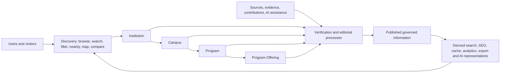

# Institutes Directory — Product and Functional Requirements

## 1. Document Information

| Field | Value |
| --- | --- |
| Document ID | MOD-001 |
| Title | Institutes Directory — Product and Functional Requirements |
| Project | eStudent.pk — Institutes & Education Directory |
| Status | Approved module requirements baseline; implementation remains unapproved |
| Documentation language | English |
| Permanent public module root | <https://estudent.pk/institutes/> |
| Governing documents | [FND-001](../00-foundation/MASTER_PROJECT_INDEX.md); [FND-002](../00-foundation/PROJECT_CONSTITUTION.md); [ARC-001](../01-architecture/SYSTEM_ARCHITECTURE.md); [ARC-002](../01-architecture/DOMAIN_MODEL_AND_BOUNDED_CONTEXTS.md); [ARC-003](../01-architecture/DATA_ARCHITECTURE_AND_LIFECYCLE.md) |
| Last updated | 2026-09-07 |

This document approves product outcomes and technology-neutral requirements for the first permanent module. It does **not** approve implementation architecture, technologies, schemas, APIs, interface designs, vendors, infrastructure, or delivery sequencing.

## 2. Purpose

Define the durable requirements for a Pakistan-focused directory that helps people discover and assess legitimate educational institutions while preserving trustworthy, attributable, temporal information over a 20+ year horizon.

## 3. Module Identity

The Institutes Directory is the eStudent.pk module rooted permanently at <https://estudent.pk/institutes/>. It is an umbrella directory for universities, degree-awarding institutions, colleges, schools, technical, vocational, training, professional institutes, academies, and other legitimate educational institutions where appropriate.

## 4. Module Vision

Make useful, trustworthy educational discovery possible across Pakistan without presenting incomplete, uncertain, user-submitted, collected, or AI-produced information as settled fact.

## 5. Module Mission

Publish governed institution, campus, program, and offering information; enable discovery and comparison; and sustain correction, verification, provenance, historical continuity, and controlled evolution.

## 6. Relationship to the Overall eStudent.pk Platform

The module is the primary initial eStudent.pk education-directory domain. It may supply governed information to later eStudent.pk modules through approved boundaries, but neither future modules nor external services redefine its canonical facts.

## 7. Relationship to Governing Documents

FND-001 supplies project identity, document system, permanent root, and long-term direction. FND-002 governs documentation-first work, distinction of requirements from decisions and ideas, URL governance, trust, security, accessibility, and AI principles. ARC-001 supplies system boundaries and conceptual layers. ARC-002 supplies bounded contexts and the domain distinctions below. ARC-003 governs ownership, lifecycle, provenance, verification, temporal applicability, history, canonical and derived information. In a conflict, the approved governance hierarchy and change process apply; this document does not amend them.

## 8. Target Users

Primary users are prospective students, parents/guardians, current learners, educators, career advisers, and visitors researching Pakistan education. Secondary users are authorized editorial, verification, and moderation staff. Future approved audiences may include institutional representatives, partners, researchers, and application clients.

## 9. Primary User Problems

Users face fragmented, stale, ambiguous, promotional, inaccessible, or incomplete institutional information; difficulty locating appropriate campuses and offerings; uncertainty about applicability of admissions, fees, merit, scholarship, and recognition information; and inability to distinguish official, verified, editorial, user-provided, and AI-assisted material.

## 10. Core User Goals

Users must be able to discover institutions; search by name, location, type, program, and discipline; investigate campus-specific information and opportunities; understand status, source, verification, and freshness; compare responsibly; move from results to useful detail; share durable public pages; and explore related institutions and programs.

## 11. Module Scope

Scope includes governed directory identity, campus and geography information, program and offering discovery, contextual admissions/fees/merit/scholarship/recognition information, facilities, contact details, public discovery, editorial and verification processes, provenance, quality, historical continuity, and derived discovery/SEO representations.

## 12. Explicit Out-of-Scope Areas

This baseline does not approve enrolment, payments, admissions decisions, institutional operations, learning delivery, credential issuance, legal compliance determinations, rankings methodology, advertisements, a specific map/search/AI service, database technology, framework, API, UI, infrastructure, hosting, deployment, or any implementation. A listed future capability is not current scope.

## 13. Institution Discovery Requirements

Discovery must support legitimate institution types without assuming identical attributes. It must make the institution’s category, status, geographic context, and availability of governed information understandable, and must not imply completeness where records are partial.

## 14. Institution Profile Requirements

A public institution profile must present the enduring institution identity separately from campuses, programs, offerings, and time-sensitive claims. It must provide meaningful information, links to relevant detail, applicable verification/freshness context, and correction-aware public representation.

## 15. Campus Requirements

An Institution may have one or more Campuses. Each Campus must retain its own identity, operational status where known, and relationship to the Institution; campus facts must not be silently generalized to every campus or to the institution overall.

## 16. Location and Geography Requirements

A Campus must have independently representable location/geographic identity when known. Geography must accommodate Pakistan’s country, province/territory, division, district, tehsil/subdivision, city, locality/area and future classifications without requiring every level, precise coordinates, or a map service.

## 17. Program Discovery Requirements

Discovery must support Programs and fields/disciplines as reusable concepts, including naming variations and evolving education terminology. A Program must not be represented only as ungoverned text or presumed available at every institution/campus.

## 18. Program Offering Requirements

A Program Offering is a contextual availability relationship between an Institution or Campus and a Program. It must remain distinct from its Program and accommodate applicable availability period, delivery/academic context, and uncertainty where material; absence of an offering must not be inferred from missing data.

## 19. Admissions Requirements

Admissions information must be contextualized to the applicable institution, campus, offering, intake/cycle, eligibility, method, deadline, source, verification, and effective period where known. It must not promise admission outcomes or treat a changing rule as permanent.

## 20. Fees and Cost Information Requirements

Fees and costs must identify applicable fee type, institution/campus/program/offering or session context, period, caveats, currency or value context where supplied, source, and verification state. Unknown, variable, or incomplete amounts must remain explicit rather than estimated as fact.

## 21. Merit Requirements

Merit information must retain selection, category/quota, offering, cycle/year/session, method, source, and verification context where known. It must not imply comparability between unlike merit lists, cycles, categories, or selection methods.

## 22. Scholarship Requirements

Scholarships and financial aid must be represented as time-bound opportunities with eligibility, applicability, source, and verification context where material. They are not a universal benefit of an Institution, Campus, or Program.

## 23. Accreditation / Recognition Requirements

Recognition, accreditation, affiliation, licensing, approval, or similar claims must identify the claim type, applicable subject and period, supporting source, verification state, and any uncertainty. The module must permit multiple relevant authorities without hard-coding one permanent regulator or asserting legal conclusions beyond evidence.

## 24. Facilities and Services Requirements

Facilities and services may be published when relevant, attributable, scoped to the institution or campus, and governed for freshness. Promotional descriptions, accessibility services, housing, transport, digital services, and other attributes must not be assumed universal or current.

## 25. Contact and Official Website Requirements

Contact information and official web links must identify their applicable institution/campus scope, source, verification/freshness where material, and status when no official online information is known. A shared website or contact channel must not prove shared institutional identity.

## 26. Search Requirements

Search must support institution name and aliases, city/location, institution type, program, and field/discipline discovery, including controlled handling of local naming variations. Results must lead to governed detailed information and distinguish no result from unavailable or unindexed information where feasible.

## 27. Filtering Requirements

Filters may narrow discovery by information that is appropriately governed, such as type, geography, public/private distinction, program/discipline, and verification/freshness context. Filters must disclose material limitations and must not claim exhaustive coverage when data is incomplete.

## 28. Sorting Requirements

Sorting may support user-understandable discovery needs, but its basis must be explainable and must not silently equate prominence, sponsorship, recency, distance, completeness, or editorial selection with quality or rank.

## 29. Nearby / Location-Based Discovery Requirements

Nearby discovery may use supplied or approved location context to identify relevant campuses. It must preserve privacy, work conceptually without precise location permission, communicate approximation/coverage limits, and never make location collection a prerequisite for core directory access.

## 30. Map / Geographic Discovery Requirements

Geographic discovery may present mapped or geographic representations of governed campus locations. It must remain optional to core information access, handle incomplete/approximate locations honestly, and not make a third-party map provider authoritative for the directory.

## 31. Compare Requirements

Comparison must permit users to compare selected institutions, campuses, or offerings only within clearly stated scope. It must show applicability, source, verification, and missing-data distinctions; it must avoid generating a composite quality judgment absent a separately approved methodology.

## 32. Rankings / Top-List Requirements

Rankings or top lists are not approved as an authoritative quality system by this baseline. If later approved, each must disclose purpose, criteria, scope, methodology, evidence, time period, editorial/sponsored status, limitations, and correction path; simple discovery ordering is not a ranking.

## 33. User Reviews and User-Generated Content Requirements

Future reviews, ratings, corrections, or claims must remain distinct from institutional facts, external-source claims, editorial material, and AI output. They require approved identity/account, consent, moderation, abuse, visibility, correction, retention, and appeal requirements before public introduction.

## 34. Editorial / Administrative Requirements

Authorized staff must be able to create, review, amend, verify, publish, unpublish, archive, and correct governed records within explicit authority. Editorial explanations and decisions must remain distinguishable from source assertions and canonical facts.

## 35. Data Verification Requirements

Material claims must support governed verification states distinct from source identity, editorial approval, confidence, and publication status. Verification must record accountable assessment and must support pending, disputed, superseded, expired, rejected, or unable-to-verify conditions as later specified.

## 36. Data Provenance and Source Requirements

Material published claims require traceable source identity, reference, collection context, assertion/evidence, scope, relevant dates, assessment, and acceptance/amendment rationale. Official and third-party sources must remain distinguishable; collection alone never makes data canonical.

## 37. Data Freshness Requirements

The module must communicate when important published information was last checked, verified, updated, or confirmed where available, in a way appropriate to its volatility. Staleness is a review condition, not proof of falsity, and must support review, warning, withdrawal, or replacement under governed rules.

## 38. Historical Data Requirements

Material historical identity, status, location, offerings, admissions, fees, merit, scholarship, recognition, and contact changes must not be silently destroyed. Superseded information must retain sufficient temporal and provenance context for legitimate history, audit, correction, and URL continuity needs.

## 39. Conflicting Information Requirements

Conflicting assertions must be preservable and resolvable without overwriting their source context. A governed process must record the conflict, assessment, decision, rationale, and resulting publication treatment, while allowing uncertainty when no conclusion is justified.

## 40. Data Quality Requirements

Data quality must address completeness, accuracy, consistency, timeliness, uniqueness/identity ambiguity, provenance, applicability, and publishability. The module must support incomplete records and identify records requiring review without inventing missing values.

## 41. AI-Assisted Capabilities

Future AI may assist structured extraction, change/staleness detection, missing-information suggestions, source comparison, conflict detection, categorization, verified-data summaries, search, recommendations, natural-language and multilingual discovery. Such outputs remain attributable, reviewable, removable, and non-canonical until accepted through governed processes.

## 42. AI Governance Requirements

AI must remain an assistant to governed data processes unless a later approved document explicitly authorizes a specific automated action. AI must not silently become canonical authority, conceal its role, overwrite source material/history, or present unsupported output as verified. Any future AI use requires defined accountability, permitted inputs, review, safety, quality, provenance, and replacement/removal paths.

## 43. SEO Requirements at the Product-Requirement Level

The module must protect stable, human-readable, useful public representations; canonical content; meaningful internal relationships; scalable discoverability; avoidance of thin, duplicate, misleading, or unverified pages; structured-information readiness; and governed historical URL changes. It does not prescribe technical SEO implementation or markup.

## 44. Search-Engine Discoverability Requirements

Useful institution, program, and location information should be discoverable for relevant search intent where publication and quality rules permit. Derived SEO metadata, indexes, sitemaps, summaries, and caches are derived information with lineage and refresh governance, not canonical facts.

## 45. Accessibility Requirements

Public and authorized-user requirements must support understandable, navigable, perceivable, operable, and robust access for people with varied abilities, devices, languages, connectivity, and assistive needs. Detailed standards and testing criteria require later approved specifications.

## 46. Mobile and Responsive Requirements

The module must remain useful for mobile and varied screen/device conditions, including constrained connectivity and touch/keyboard use where applicable. This is an outcome requirement, not approval of a frontend approach.

## 47. Performance Requirements

Discovery and essential public information must remain responsive enough for practical use under expected Pakistan-focused access conditions and controlled growth. Later specifications must set measurable, justified targets without sacrificing provenance, correctness, accessibility, or technology neutrality.

## 48. Security and Privacy Requirements

The module must apply least privilege, secure defaults, authorization, input/output safety, auditability, and protection for governed information and editorial processes. Personal/user/location data, if later collected, requires defined purpose, minimization, access, retention, correction/deletion handling, and approved legal assessment; this document makes no compliance claim.

## 49. Analytics and Measurement Requirements

Future measurement may assess discovery usefulness, content gaps, quality/freshness workload, accessibility, search outcomes, and feature effectiveness. Analytics must be derived, purpose-limited, privacy-governed, attributable where material, and must not redefine canonical facts or silently introduce tracking.

## 50. Future API / Integration Requirements

Future APIs and integrations are Future capabilities and require separately approved contracts, versioning, authorization, lifecycle, change/deprecation, privacy, provenance, and quality requirements. External inputs are evidence or proposed changes, not automatic canonical data.

## 51. Future Mobile Application Requirements

A future mobile application may consume governed representations through approved interfaces while preserving URL, data-meaning, privacy, and accessibility commitments. It is not approved for implementation by this document.

## 52. Future Automation Requirements

Future automation may collect, monitor, validate, refresh, derive, or notify only through approved, observable, reversible, and accountable workflows. It must preserve source context, uncertainty, review pathways, and lifecycle controls.

## 53. Future AI-Agent Requirements

Future AI agents for monitoring/update workflows require explicit approved action boundaries, human accountability, source permissions, review/escalation, auditability, rate/impact safeguards, and a disable/removal path. They may not autonomously establish institutional truth absent later explicit approval.

## 54. Notifications / Alerts as a Future Capability

Future alerts may notify users or staff of verified/appropriate changes, deadlines, reviews, or subscriptions. They require separate requirements for consent, targeting, frequency, privacy, accuracy, delivery failure, preference management, and lifecycle.

## 55. Admin and Editorial Workflow Requirements

Workflows must support intake, source/evidence recording, review, verification, conflict resolution, amendment, publication state, staleness queues, archival, user-submission review, change tracking, and quality review. Authority, segregation of duties, escalation, and detailed state transitions require later specifications.

## 56. User Account Requirements as a Future Capability

Accounts are not required for core public discovery. If later approved for contributions, saved comparisons, alerts, or personalization, requirements must define identity, consent, privacy, security, moderation, portability, retention, and deletion/correction handling.

## 57. Monetization Boundaries and Principles

No monetization model is approved. Any future sponsorship, promotion, subscription, lead generation, or partnership must preserve editorial independence, factual distinction, user clarity, privacy, discoverability fairness, conflict disclosure, and correction paths; paid placement must never masquerade as verification or merit.

## 58. Interoperability Requirements

The module must preserve comprehensible identifiers, meanings, provenance, dates, classifications, and status so later approved representations and exchanges can interoperate without losing context. Interoperability does not authorize uncontrolled data copying or external ownership.

## 59. Backward Compatibility Requirements

Public module-root and established public representations are long-term assets. Material URL, identity, meaning, classification, integration, or published-data changes require documented impact assessment, approved governance, historical preservation, and compatible transition/redirect strategy where applicable.

## 60. Scalability Requirements

The requirements must scale conceptually from early records to thousands of institutions, campuses, programs, offerings, sources, and derived representations without collapsing domain distinctions or abandoning quality and traceability. Detailed capacity design is deferred.

## 61. Long-Term Maintainability Requirements

The module must be understandable and changeable over 20+ years through stable terminology, documented ownership, traceable requirements, controlled classifications, durable identifiers and URLs, audit/history, replaceable implementations, and incremental reviewed change.

## 62. Internationalization / Localization Future Requirements

Future localization must support English and potential Urdu/local languages, local naming variations, translation provenance, script/search needs, and fallback where translations are unavailable. It must not silently alter canonical identity or source meaning.

## 63. Pakistan-Specific Requirements

The module must represent Pakistan-focused geographic variation, provinces/territories, cities, districts, local naming, public/private distinctions, diverse education sectors, changing institutional status, and multiple relevant authorities. It must accommodate incomplete official online information and must not treat a particular regulator or taxonomy as permanently universal.

## 64. Education-System Evolution Requirements

The model must accommodate new institution types, online/hybrid forms, program and qualification structures, admission models, regulatory systems, geographic classifications, and education terminology. New concepts require governed extension rather than reinterpretation that erases prior meaning.

## 65. Requirement Priorities

**Must** means necessary for the approved module outcome and a prerequisite for later implementation acceptance. **Should** means strongly desired, deferred only with documented rationale. **Could** means valuable but optional. **Future** means non-binding capability requiring later requirements and decisions. This document’s present statements are approved requirements unless marked Future or proposal; it records no implementation decision. Ideas/proposals require validation and approval before becoming requirements.

## 66. Functional Requirement Catalogue

The following stable, conceptual requirements are grouped for later specification, test planning, data, API, UI, SEO, and implementation traceability.

| ID | Priority | Requirement |
| --- | --- | --- |
| MOD-FR-001 | Must | Maintain a governed, enduring Institution identity separate from source records, pages, brands, legal/administrative entities, and user accounts. |
| MOD-FR-002 | Must | Represent one Institution’s multiple Campuses without collapsing campus facts into institution facts. |
| MOD-FR-003 | Must | Maintain Campus location/geographic identity independently from institution identity and permit incomplete geographic detail. |
| MOD-FR-004 | Must | Represent Program separately from Program Offering, and relate an offering to an applicable Institution or Campus without assuming universal availability. |
| MOD-FR-005 | Must | Support legitimate Pakistan educational institution categories without requiring identical attributes for every category. |
| MOD-FR-006 | Must | Publish useful institution profiles that separate enduring identity from time-sensitive claims and link to relevant campuses, programs, and offerings. |
| MOD-FR-007 | Must | Enable discovery by institution name/aliases, location, type, Program, and discipline/field. |
| MOD-FR-008 | Should | Enable governed filtering and explain material completeness or applicability limitations. |
| MOD-FR-009 | Should | Enable understandable sorting without representing ordering as quality, rank, or sponsorship unless explicitly disclosed. |
| MOD-FR-010 | Could | Enable nearby discovery using optional approved location context without requiring precise user location. |
| MOD-FR-011 | Could | Enable map/geographic discovery while keeping core information usable without mapping. |
| MOD-FR-012 | Should | Enable scoped comparison with verification, source, applicability, and missing-data context. |
| MOD-FR-013 | Must | Contextualize admissions by applicable subject, cycle/intake, eligibility, period, source, and verification where known. |
| MOD-FR-014 | Must | Contextualize fees/costs by applicable subject, fee type, period/session, caveats, source, and verification where known. |
| MOD-FR-015 | Must | Contextualize merit by applicable offering/cycle/category/method and avoid unsupported comparisons. |
| MOD-FR-016 | Must | Contextualize scholarships/aid by eligibility, applicability, period, source, and verification where material. |
| MOD-FR-017 | Must | Represent recognition/accreditation-related claims with claim type, scope, period, evidence, and verification rather than a universal label. |
| MOD-FR-018 | Should | Publish governed campus/institution facilities, services, contact channels, and official web links with scope and freshness context. |
| MOD-FR-019 | Must | Keep canonical facts, external-source assertions, evidence, editorial material, user-generated material, AI material, and derived information distinguishable. |
| MOD-FR-020 | Must | Retain traceable provenance, source identity, evidence, assessment, verification, applicability, and material change context for published claims. |
| MOD-FR-021 | Must | Support uncertainty, incomplete information, verification state, and freshness/staleness without inventing missing facts. |
| MOD-FR-022 | Must | Preserve material historical and superseded information with temporal context and correction traceability. |
| MOD-FR-023 | Must | Support recorded conflict identification, assessment, resolution rationale, and publication treatment without erasing conflicting assertions. |
| MOD-FR-024 | Must | Enable authorized editorial staff to create, review, amend, verify, publish, unpublish, archive, and quality-review records within governed authority. |
| MOD-FR-025 | Must | Support review queues or equivalent identification of stale, incomplete, conflicting, disputed, or otherwise review-needed information. |
| MOD-FR-026 | Future | Support governed moderation of user reviews, ratings, corrections, and claims without allowing them to directly alter canonical facts. |
| MOD-FR-027 | Must | Preserve the permanent public module root `https://estudent.pk/institutes/` and govern material public URL changes. |
| MOD-FR-028 | Should | Provide stable, meaningful public representations and related-content pathways for institution, program, and location discovery. |
| MOD-FR-029 | Future | Support approved APIs/integrations only as governed, versioned contracts with controlled input/output lifecycles. |
| MOD-FR-030 | Future | Permit AI-assisted extraction, monitoring, search, summaries, recommendations, and agents only under governed human-accountable processes. |
| MOD-FR-031 | Future | Permit user accounts, saved information, alerts, mobile clients, multilingual experiences, voice, and new discovery modes only through later approved requirements. |

## 67. Non-Functional Requirement Catalogue

| ID | Priority | Requirement |
| --- | --- | --- |
| MOD-NFR-001 | Must | Preserve semantic data integrity, ownership, provenance, verification, applicability, and history across representations and changes. |
| MOD-NFR-002 | Must | Support secure, least-privilege, auditable access appropriate to public, editorial, and future contributor responsibilities. |
| MOD-NFR-003 | Must | Protect privacy through purpose limitation, minimization, controlled access, and governed retention for any personal data later introduced. |
| MOD-NFR-004 | Must | Remain accessible and understandable across varied abilities, devices, connectivity, and future language needs. |
| MOD-NFR-005 | Must | Remain mobile-ready and usable under constrained connectivity without requiring a particular interface technology. |
| MOD-NFR-006 | Should | Deliver practical discovery and essential information performance under expected use and controlled growth; measurable targets require later specification. |
| MOD-NFR-007 | Should | Preserve availability and resilience of critical public information under partial capability failure where practical. |
| MOD-NFR-008 | Must | Scale conceptually to long-term growth in entities, relationships, history, sources, and derived representations. |
| MOD-NFR-009 | Must | Keep implementation choices portable and replaceable without changing durable meaning, provenance, public URLs, or approved requirements. |
| MOD-NFR-010 | Must | Remain maintainable through clear boundaries, documented terminology, controlled change, and traceable decisions. |
| MOD-NFR-011 | Must | Provide observability and audit-readiness for material editorial, verification, publication, derivation, and automation actions. |
| MOD-NFR-012 | Must | Ensure derived search, SEO, cache, analytics, export, and AI representations have governed lineage/freshness and never become canonical silently. |
| MOD-NFR-013 | Should | Support SEO scalability, useful indexation, canonical representations, and duplicate/thin-content avoidance for growing coverage. |
| MOD-NFR-014 | Future | Support API/integration compatibility, lifecycle, and deprecation governance before external reliance. |
| MOD-NFR-015 | Future | Support AI safety, transparency, reviewability, provenance, replacement, and safe disablement before public AI reliance. |
| MOD-NFR-016 | Must | Support backward-compatible evolution and governed transitions for public URLs, identifiers, classifications, and material data meaning. |
| MOD-NFR-017 | Must | Support extensibility for changing Pakistan education, geographic, regulatory, and linguistic systems without destructive reinterpretation. |
| MOD-NFR-018 | Should | Support purpose-limited, privacy-governed measurement without silently introducing user tracking or data misuse. |

## 68. Acceptance-Readiness Principles

Later implementation work is acceptance-ready only when it traces to approved requirements; preserves governing domain and data distinctions; defines testable acceptance criteria, ownership, error/uncertainty behavior, accessibility, security/privacy, and operational evidence; identifies dependencies and change impact; and receives the approvals required by FND-002. This document itself does not accept an implementation.

## 69. Dependencies

This module depends on the five governing documents cited in Section 1, including their approved terminology and change process. Later work will depend on approved detailed data, UI/UX, SEO, API, AI, testing, security/privacy, and decision documentation as applicable; none is created or approved here.

## 70. Risks and Constraints

Key risks include incomplete or changing source information; identity ambiguity; local naming variation; misleading comparisons; stale time-sensitive facts; regulatory change; source access/rights limitations; review capacity; abuse in future user content; privacy concerns; AI hallucination or overreach; URL instability; and premature technology/vendor coupling. Constraints include the permanent module root, documentation-first governance, technology neutrality, 20+ year evolution, and the need not to mistake collection, derivation, or automation for authority.

## 71. Current Module Requirements Status

MOD-001 is the approved technology-neutral requirements baseline. It approves the outcomes and constraints in Sections 2–68 and the catalogues in Sections 66–67. It does not approve coding, data schema, technology selection, public page design, implementation sequence, source integrations, service providers, or production operations. No implementation should proceed beyond governing-approved planning without the relevant subsequent specifications and decisions.

## 72. Future Module Requirements Areas

Future documents may, after review, define detailed requirements for data structures and taxonomy governance, editorial roles/state transitions, source/evidence policy, verification/freshness rules, UI/UX, search behavior, geographic/mapping behavior, comparison and ranking methodology, moderation/accounts, SEO design, API contracts, mobile applications, automation, AI, accessibility testing, security/privacy, analytics, monetization, and integrations. These are future work areas, not approved implementation commitments.

## Appendix A. Conceptual Information Flow

The diagram is conceptual and technology-neutral. Derived representations consume governed published information and do not become the canonical authority.
