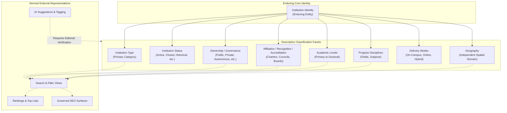

# Institutes Directory — Taxonomy and Classification Specification

## 1. Document Information

| Field | Value |
| --- | --- |
| Document ID | MOD-004 |
| Title | Institutes Directory — Taxonomy and Classification Specification |
| Project | eStudent.pk — Institutes & Education Directory |
| Status | Approved module specification |
| Scope | Technology-neutral taxonomy and classification principles |
| Documentation language | English |
| Default branch | `main` |
| Last updated | 2026-09-08 |

This document establishes conceptual classification principles only. It approves no database schema, SQL DDL, tables, columns, migrations, API contracts, routing implementation, frontend components, or technology stack choices.

## 2. Purpose

MOD-004 defines the technology-neutral taxonomy and classification principles for the eStudent.pk Institutes & Education Directory. It establishes a durable conceptual classification system designed to remain useful and coherent for 20+ years of institutional, academic, regulatory, and pedagogical change in Pakistan's educational landscape.

Taxonomy serves to describe, organize, and discover governed educational information. Taxonomy must never replace or compromise enduring institution identity.

## 3. Scope

The scope of this specification encompasses:

- Conceptual taxonomy principles and multi-dimensional classification philosophy.
- The fundamental independence of Institution Identity from all descriptive classifications.
- Primary institution categories (universities, colleges, schools, technical, vocational, training/skills, professional/specialized, religious/faith-based, distance/alternative, and emerging categories).
- Conceptual classification distinctions across institutional status, ownership and governance, affiliation, recognition, accreditation, academic levels, disciplines, fields, delivery modes, study patterns, and admission cycles.
- The strict independence of geographic place from institutional taxonomy.
- The boundary between canonical classification and derived representations (search filters, rankings, SEO surfaces, and AI-generated labels).
- Controlled vocabulary governance, versioning, historical preservation, reclassification rules, handling of ambiguous/unknown states, and dispute resolution.
- Taxonomy quality dimensions and 20+ year extensibility protocols.

This specification does not approve:
- Database schemas, SQL definitions, table structures, column datatypes, or migration scripts.
- Programming languages, software frameworks, database engines, or infrastructure choices.
- API endpoints, request/response schemas, or serialization formats.
- Frontend components, UI widgets, CSS frameworks, or routing code.
- Search indexing engines, ranking algorithms, or map providers.
- Specific AI models, third-party AI services, or automated scraping tools.

## 4. Governing Documents

This document is governed by and must be read consistently with the approved foundation and architecture baselines:

- [FND-001: Master Project Index](../00-foundation/MASTER_PROJECT_INDEX.md) — Establishes project identity, vision, documentation hierarchy, and the permanent public module root `<https://estudent.pk/institutes/>`.
- [FND-002: Project Constitution](../00-foundation/PROJECT_CONSTITUTION.md) — Establishes durable project governance, the documentation-first rule, data integrity principles, and change management processes.
- [ARC-001: System Architecture](../01-architecture/SYSTEM_ARCHITECTURE.md) — Establishes technology-neutral architectural layers, modular boundaries, and quality concerns.
- [ARC-002: Domain Model and Bounded Contexts](../01-architecture/DOMAIN_MODEL_AND_BOUNDED_CONTEXTS.md) — Defines bounded domain contexts including Institution, Campus, Program, Program Offering, Geography, and Discovery.
- [ARC-003: Data Architecture and Lifecycle](../01-architecture/DATA_ARCHITECTURE_AND_LIFECYCLE.md) — Defines data governance, provenance, verification, temporal validity, and the lifecycle of governed information.
- [MOD-001: Institutes Directory Requirements](INSTITUTES_DIRECTORY_REQUIREMENTS.md) — Establishes functional and quality requirements for the directory module.
- [MOD-002: Institutes Directory Information Architecture and URLs](INSTITUTES_DIRECTORY_INFORMATION_ARCHITECTURE_AND_URLS.md) — Establishes public information architecture, canonical URLs, and discovery representations.
- [MOD-003: Institutes Directory Information Specification and Content Governance](INSTITUTES_DIRECTORY_INFORMATION_SPECIFICATION.md) — Establishes information meaning, source authority, verification, freshness, and the boundary between canonical and derived information.

MOD-004 defines taxonomy and classification principles for organizing and describing the information governed by MOD-003. MOD-004 does not amend or override any governing document.

## 5. Taxonomy Principles

**MOD-TAX-001 — Taxonomy serves governed information.** Taxonomy values and classification assignments exist to organize, contextualize, and make discoverable verified educational entities. A taxonomy label or category has no independent authority to override governed facts, evidence, or provenance.

**MOD-TAX-002 — Durability and semantic stability.** Taxonomy definitions must be durable across decades. A category must represent a clear, distinct conceptual meaning that remains understandable even as statutory frameworks, administrative naming conventions, or marketing terminologies change.

**MOD-TAX-003 — Multi-dimensional faceted independence.** Educational institutions cannot be accurately modeled by a single monolithic hierarchy. Classification dimensions—including institution type, operational status, governance model, statutory recognition, academic levels, disciplines, and delivery modes—must remain conceptually independent facets that can be combined without semantic collisions.

## 6. Classification Philosophy

The classification philosophy of the directory is descriptive, evidence-grounded, and poly-hierarchical:

1. **Descriptive, not prescriptive:** Taxonomy documents what institutions legitimately are and offer based on verified evidence, rather than dictating what they ought to be.
2. **Multi-faceted over single-tree:** An institution is not forced into an artificial single-parent tree. A polytechnic college offering both technical diplomas and higher secondary certificates is classified along multiple distinct facets (institution type, academic levels, vocational awards) rather than shoehorned into an arbitrary single bucket.
3. **Evidence-backed attribution:** Every classification assigned to an institution must be traceable to reliable sources and verification under MOD-003 rules.
4. **Resilience to structural reform:** National and provincial educational systems periodically restructure levels, boards, councils, and qualifications. The taxonomy must accommodate structural shifts through versioned concepts and explicit temporal validity without breaking historical continuity.

## 7. Institution Identity versus Classification

**MOD-TAX-004 — Independence of identity from classification.** Institution identity represents an enduring educational organization and is strictly independent of any classification assigned to it. A change in an institution's type, ownership, legal charter, recognition status, affiliation, academic scope, or delivery model must never automatically destroy, fragment, or recreate its institution identity.

When an intermediate college is chartered as a full degree-awarding university, the underlying organization undergoes an institutional evolution. Its identity persists; its classification facet transitions from college to university with appropriate effective dates, historical lineage, and audit records as required by ARC-002, ARC-003, and MOD-003.

The diagram demonstrates that descriptive classification facets branch from and describe the central enduring Institution Identity. Derived discovery views, rankings, SEO surfaces, and AI suggestions consume these facets downstream but never define identity or alter canonical classifications.

## 8. Institution Type Concept

**MOD-TAX-005 — Primary institution type concept.** An institution's primary type represents its core educational organizational character for orientation, baseline categorization, and intuitive public discovery.

The primary type designates the primary functional category under which the institution operates (e.g., University, College, School, Technical Institute). It acts as a primary navigational anchor but does not act as an exclusive constraint on secondary characteristics or offerings.

## 9. Primary Institution Categories

**MOD-TAX-006 — Extensible primary categories.** The directory conceptually supports the following primary institution categories, which represent extensible conceptual boundaries rather than an exhaustive or closed programmatic enumeration:

1. **Universities:** Higher education degree-granting institutions with statutory degree-awarding authority.
2. **Colleges:** Post-secondary educational institutions offering intermediate, undergraduate, professional, or associate qualifications.
3. **Schools:** Elementary, middle, and secondary educational institutions providing foundational and general education.
4. **Technical Institutions:** Specialized institutions delivering formal technical education, polytechnic curricula, and applied engineering technologies.
5. **Vocational Institutions:** Practical education centers providing occupational training, trade credentials, and vocational certificates.
6. **Training and Skills Institutions:** Professional development centers, IT academies, short-cycle skills providers, and continuing education institutes.
7. **Professional and Specialized Institutions:** Institutions dedicated to specific professional disciplines (e.g., judicial academies, civil service academies, specialized banking academies).
8. **Religious and Faith-Based Educational Institutions:** Traditional religious educational institutions, seminaries, and faith-affiliated educational bodies.
9. **Distance, Online, and Alternative Education Institutions:** Providers whose core organizational structure is predicated on open, virtual, correspondence, or non-formal educational delivery.
10. **Other Legitimate Categories:** Emerging, hybrid, or distinct institutional forms that satisfy verification and directory inclusion criteria.

## 10. University Classification

**MOD-TAX-007 — Conceptual university classification.** Universities must be classifiable by conceptual operational and statutory characteristics without requiring implementation enums:

- **Broad-Scope vs. Specialized Universities:** General comprehensive universities offering multifaceted academic faculties versus focused specialized universities (e.g., Engineering & Technology, Medical & Health Sciences, Agriculture, Management & Business, Fine Arts & Design).
- **Statutory Authority Context:** Federal charter, provincial charter, or recognized degree-awarding institute (DAI) status under applicable statutory frameworks.
- **Constituent Architecture:** Unitary campus institutions versus collegiate federated universities operating constituent colleges and faculties.
- **Research vs. Teaching Focus:** Conceptual orientation toward post-graduate doctoral research versus undergraduate instructional focus.

These distinctions describe institutional nature; they do not dictate statutory claims or legal findings by the directory.

## 11. College Classification

**MOD-TAX-008 — Conceptual college classification.** Colleges encompass diverse post-secondary educational bodies and must support clear conceptual distinctions:

- **Intermediate / Higher Secondary Colleges:** Institutions primarily preparing students for intermediate examinations (e.g., HSSC, FA, FSc, ICS, ICom, A-Levels).
- **Degree Colleges:** Institutions offering post-intermediate undergraduate programs (e.g., Associate Degrees, BS 4-year programs).
- **Postgraduate Colleges:** Colleges authorized to offer master's level programs under university affiliation.
- **Professional Colleges:** Specialized colleges focused on specific professions (e.g., Medical Colleges, Dental Colleges, Law Colleges, Commerce Colleges, Nursing Colleges, Pharmacy Colleges, Fine Arts Colleges).
- **Affiliated Colleges:** Independent institutional bodies delivering academic curricula examined and conferred by an affiliated chartered university.
- **Constituent Colleges:** Semantically integral academic units owned and directly administered as constituent components of a parent university.
- **Cadet and Military Colleges:** Specialized preparatory institutions combining general education with military discipline and leadership training.

## 12. School Classification

**MOD-TAX-009 — Conceptual school classification.** School classification must support educational level spans and specialized operational missions:

- **Early Childhood / Pre-Primary Schools:** Nurseries, kindergartens, and early development centers.
- **Primary Schools:** Foundational grade institutions (typically Grades 1 through 5).
- **Middle / Elementary Schools:** Intermediate grade institutions (typically Grades 6 through 8).
- **Secondary / High Schools:** Secondary graduation institutions preparing for Matriculation (SSC) or international examinations (e.g., Cambridge O-Levels / IGCSE).
- **Higher Secondary Schools:** Schools offering extended secondary education through intermediate levels (Grades 11–12 / Cambridge A-Levels).
- **Composite / Comprehensive Schools (K-12):** Integrated institutions spanning foundational early education through higher secondary completion.
- **Specialized Schools:** Institutions tailored for specific student needs, including special education schools (visual, hearing, physical, or developmental needs) and sports/arts academies.

## 13. Technical and Vocational Classification

**MOD-TAX-010 — Distinction between technical and vocational education.** The taxonomy must maintain a clear conceptual distinction between technical education and vocational training:

- **Technical Institutions:** Polytechnic institutes, colleges of technology, and mono-technical institutes offering structured multi-year post-secondary technical curricula leading to associate engineering diplomas (e.g., DAE) or bachelor of technology degrees.
- **Vocational Institutions:** Centers, vocational training institutes (VTIs), and trade schools focused on manual, technical, and occupational crafts leading to skill certificates, trade certifications, and apprenticeship completions.

Both categories emphasize practical competencies but differ in curriculum duration, academic entry prerequisites, theoretical depth, and credentialing pathways.

## 14. Training and Skills Institution Classification

**MOD-TAX-011 — Training and skills classification.** Training and skills institutions represent flexible, competency-oriented education outside traditional degree tracks:

- **Information Technology Academies:** Specialized institutes providing software development, cloud computing, cybersecurity, and digital skills certifications.
- **Corporate and Management Training Institutes:** Organizations focused on executive coaching, leadership development, project management, and corporate upskilling.
- **Vocational and Industrial Skills Centers:** Skill training units focused on emerging industry trades, manufacturing automation, and service-sector proficiencies.
- **Language and Test-Preparation Centers:** Specialized centers delivering language proficiencies and standardized academic admission test preparations.

These entities are classified by skill domains, certification nature, and target learners, distinct from formal academic institutions.

## 15. Professional and Specialized Institution Classification

**MOD-TAX-012 — Professional and specialized institutions.** Certain educational bodies serve specialized professional sectors and operate under distinct statutory or institutional mandates:

- **Civil Service and Administrative Staff Colleges:** National and provincial academies training public administration officers.
- **Judicial Academies:** Specialized institutions dedicated to judicial training, continuing legal education, and court administration.
- **Banking, Financial, and Insurance Academies:** Specialized institutes preparing professionals for financial institutions, central banks, and capital markets.
- **Armed Forces and Defence Academies:** Military academies and staff colleges delivering officer education, strategy, and defence studies.
- **Specialized Creative and Performing Arts Academies:** Dedicated national institutions for film, music, theatre, and heritage crafts.

## 16. Religious and Faith-Based Educational Institution Classification

**MOD-TAX-013 — Religious and faith-based classification.** Religious and faith-based institutions represent a major segment of historical and contemporary education in Pakistan:

- **Dini Madaris / Seminaries:** Traditional Islamic educational institutions providing religious curricula, Hifz, Dars-e-Nizami, and advanced theological specializations across various recognized educational boards (Wifaqs/Tanzeems).
- **Faith-Affiliated General Schools and Colleges:** Educational institutions operated by religious charities, missionary societies, or trust foundations offering standard national or international general curricula alongside pastoral care.
- **Theological Colleges and Seminaries:** Specialized colleges offering formal Christian, Islamic, or other religious theological education and ministerial training.

Classification must be objective, respectful, evidence-based, and maintain clear records of statutory recognition, board affiliations, and educational equivalence where verified.

## 17. Distance, Online, and Alternative Education Classification

**MOD-TAX-014 — Distance and alternative education classification.** Institutions whose operational model diverges from physical campus instruction require clear conceptual categorization:

- **Open and Distance Universities:** Formal chartered universities operating primarily through correspondence, regional study centers, broadcasts, and asynchronous distance instruction.
- **Virtual Universities:** Fully digital higher education institutions delivering instruction primarily via internet-based platforms, digital courseware, and virtual laboratories.
- **Non-Formal Basic Education Centers:** Community-based alternative learning centers providing adult literacy, accelerated primary learning, and drop-out rehabilitation.
- **Digital and EdTech Platforms:** Online instructional providers delivering modular micro-credentials, bootcamps, and supplemental academic support.

## 18. Other Legitimate Institution Categories

**MOD-TAX-015 — Accommodation of emerging categories.** The directory must be able to accommodate new, emerging, or hybrid institutional forms that meet verified inclusion criteria:

- Independent research institutes offering affiliated postgraduate degrees.
- Public-private hybrid educational incubators.
- International branch centers and foreign-collaborative study institutions.
- Community learning centers and adult education foundations.

Classification rules must allow legitimate new categories to be established under formal taxonomy governance without destabilizing existing classifications.

## 19. Multi-Type and Multi-Classification Institutions

**MOD-TAX-016 — Multi-classification capability.** Real-world educational institutions frequently cross simple categorical boundaries. The taxonomy must support multi-type and multi-faceted classification:

- An institution may possess a single **Primary Institution Type** (e.g., College) while simultaneously maintaining valid **Secondary Classifications** (e.g., Vocational Training Provider, Technical Institute).
- A composite educational institution may operate an attached elementary school, a secondary school, an intermediate college, and an evening vocational training center under one enduring corporate identity.
- Secondary classifications must be explicitly characterized as secondary attributes, preserving the clarity of the primary classification while reflecting the full scope of verified operations.

## 20. Institutional Status Classification

**MOD-TAX-017 — Independence of institutional status.** Institutional status describes the current operational, legal, or publication-relevant condition of an institution. Status is strictly independent of institution type and must not destroy or alter historical classifications:

- **Active:** Currently operational and actively providing education.
- **Temporarily Inactive:** Operations temporarily suspended (e.g., seasonal closure, facility renovation, administrative pause) with intent to resume.
- **Suspended / Barred:** Regulatory or legal suspension barring admissions or operations for a definite or indefinite period.
- **Closed / Ceased Operations:** Permanently closed with verified cessation of educational delivery.
- **Merged:** Absorbed into or unified with another institution identity (predecessor entity remains preserved in historical records).
- **Dissolved / Liquidated:** Formal corporate or statutory dissolution.
- **Relocated:** Operational presence transferred to a new geographic location (governed as campus/geographic lifecycle under MOD-002 and MOD-003).
- **Historical:** Preserved entity that ceased operations prior to modern directory monitoring or represents a significant historical predecessor.

Historical classifications (e.g., that an institution was an "Active College from 1985 to 2015") must remain fully queryable and preserved after status changes to "Closed" or "Merged".

## 21. Ownership and Governance Classification

**MOD-TAX-018 — Ownership and governance facet.** Ownership and governance describe the organizational authority, funding model, and corporate structure of an institution. This facet must remain independent of institution type:

- **Public (Federal):** Established, chartered, or funded under federal government auspices.
- **Public (Provincial):** Established, chartered, or administered under provincial governmental departments.
- **Public (Local / Municipal):** Maintained by municipal or local government authorities.
- **Private (Independent / Proprietary):** Privately owned, operated, and funded by individuals or private commercial entities.
- **Private (Non-Profit / Trust / Foundation):** Governed by non-profit trusts, philanthropic foundations, or endowments.
- **Government-Controlled / Autonomous:** Statutory autonomous bodies operating under public charters with independent boards of governors.
- **Community-Based / Cooperative:** Managed by local community associations or educational cooperatives.
- **Public-Private Partnership (PPP):** Jointly governed under formal public-private collaboration agreements.

The taxonomy documents governance models objectively based on evidence without asserting definitive legal determinations.

## 22. Affiliation and Recognition Classification

**MOD-TAX-019 — Distinction between charter, recognition, and affiliation.** The taxonomy strictly differentiates legal charter, statutory recognition, and academic affiliation:

- **Charter / Statutory Act:** The legislative instrument or government decree granting an institution legal existence and autonomous degree-conferring power.
- **Statutory Recognition:** Formal acknowledgement by an authorized governmental or statutory oversight body (e.g., federal or provincial higher education commissions, intermediate boards, technical education boards) confirming that an institution meets statutory standards.
- **Academic Affiliation:** A formal, contractual academic relationship where a non-degree-awarding college or institute teaches an approved curriculum examined, certified, and conferred by an independent chartered university or board.

An affiliated college is not a university; an affiliated college’s programs lead to credentials awarded by its parent affiliating university. The taxonomy must model affiliating body relationships explicitly.

## 23. Accreditation and Regulatory Classification

**MOD-TAX-020 — Accreditation and regulatory oversight.** Accreditation represents quality assurance evaluation and professional program approval, distinct from general statutory recognition or affiliation:

- **Professional Council Accreditation:** Program-specific evaluation and approval by statutory professional regulatory councils in Pakistan (e.g., PMDC for medicine/dentistry, PEC for engineering, PCATP for architecture/planning, PNC for nursing, PBC for law, NCEAC for computing, NBEAC for business, NACTE for teacher education).
- **Institutional Quality Ratings / Accreditation:** Holistic institutional evaluations conducted by authorized accreditation councils or quality assurance agencies.
- **Regulatory Standing:** Inspection status, intake permission, and compliance notifications issued by regulatory bodies.

Accreditation applies primarily to specific programs or faculties rather than whole institutions, and must be classified with explicit scope, issuing council, and validity timeframes.

## 24. Academic Level Classification

**MOD-TAX-021 — Academic level facet.** Academic level represents the educational tier or qualification stage of programs offered. Academic level is independent of institution type:

- **Early Childhood Education (Pre-Primary)**
- **Primary (Grades 1–5)**
- **Middle / Lower Secondary (Grades 6–8)**
- **Secondary (Grades 9–10 / Matriculation / SSC / O-Levels)**
- **Higher Secondary (Grades 11–12 / Intermediate / HSSC / A-Levels)**
- **Vocational / Technical Certificate**
- **Associate Degree / Post-Secondary Diploma (1–3 year undergraduate cycles)**
- **Undergraduate / Bachelor's Degree (e.g., BS 4-year, professional first degrees)**
- **Graduate / Master's Degree (e.g., MS, MPhil, 1–2 year advanced cycles)**
- **Postgraduate / Doctoral Degree (e.g., PhD, post-doctoral fellowships)**
- **Professional Specialization / Fellowship (e.g., FCPS, post-degree residency diplomas)**
- **Skills Training / Non-Degree Competency Awards**
- **Future Legitimate Levels:** Extensible to future qualification framework tiers.

A university may offer programs spanning higher secondary through doctoral levels; a technical college may offer vocational certificates and associate diplomas. Academic levels describe offerings, not institution identity.

## 25. Program Discipline Classification

**MOD-TAX-022 — Program discipline facet.** Program disciplines classify the broad intellectual domains of knowledge and curricula. Disciplines are independent of institution identity and institution type:

- **Computer Science & Information Technology**
- **Engineering & Technology**
- **Medical, Health & Allied Sciences**
- **Business, Management & Commerce**
- **Social Sciences & Humanities**
- **Natural Sciences & Mathematics**
- **Law & Legal Studies**
- **Education & Teacher Training**
- **Arts, Design & Architecture**
- **Agricultural & Veterinary Sciences**
- **Media, Journalism & Communication**
- **Technical Trades & Vocational Skills**
- **Islamic Studies, Theology & Religious Education**

These disciplines serve as conceptual classification anchors and are extensible as academic fields evolve.

## 26. Program Field and Subject Classification

**MOD-TAX-023 — Hierarchical and faceted subject classification.** Within broad program disciplines, the taxonomy supports granular field and subject classifications:

- Disciplines branch into **Fields** (e.g., within Computer Science: Software Engineering, Artificial Intelligence, Cybersecurity, Data Science; within Engineering: Electrical, Mechanical, Civil, Chemical; within Medicine: MBBS, BDS, Physical Therapy, Nursing, Pharmacy).
- Fields branch into specific **Subjects and Specializations** (e.g., Cloud Computing within Software Engineering; Power Systems within Electrical Engineering; Pediatrics within Medicine; Corporate Finance within Business).
- Subject classification must be poly-hierarchical where fields overlap (e.g., Bioinformatics intersects Computer Science, Natural Sciences, and Health Sciences).

## 27. Delivery Mode Classification

**MOD-TAX-024 — Delivery mode facet.** Delivery mode defines the operational method by which instruction is imparted to students. Delivery mode is an attribute of program offerings and campuses, never an immutable constraint on institution identity:

- **On-Campus (In-Person / Contact):** Instruction conducted primarily in physical classrooms, laboratories, and lecture halls.
- **Online (Digital / Asynchronous / Synchronous):** Instruction conducted primarily via internet-based digital platforms.
- **Distance / Correspondence:** Instruction conducted via self-study materials, broadcasts, and periodic regional tutorials.
- **Hybrid / Blended:** Formally structured integration of substantial in-person instruction and digital online learning.
- **Work-Integrated / Apprenticeship:** Instruction conducted substantially in industrial, clinical, or workplace settings.

## 28. Study Pattern and Attendance Classification

**MOD-TAX-025 — Study pattern and attendance facet.** Study patterns classify the scheduling structure and time commitments of educational delivery:

- **Full-Time:** Standard continuous curriculum load.
- **Part-Time:** Reduced pacing designed for concurrent employment or other commitments.
- **Morning Shift:** Standard daytime instructional schedule.
- **Evening / Second Shift:** Afternoon or evening instructional schedule commonly offered in public and private colleges.
- **Weekend / Executive:** Concentrated weekend schedules tailored for working professionals.
- **Modular / Self-Paced:** Variable duration instruction organized into independent competency units.

## 29. Admission and Intake Classification

**MOD-TAX-026 — Admission and intake patterns.** Admission patterns classify the temporal cycles under which institutions accept and enroll new cohorts:

- **Annual Intake:** Single annual admissions intake (common in schools, intermediate boards, and public universities).
- **Biannual / Semester Intake (Fall / Spring):** Twice-yearly admissions cycles aligned with standard academic semesters.
- **Trimester / Quarterly Intake:** Three or four distinct enrollment windows per calendar year.
- **Rolling / Continuous Intake:** Open-ended enrollment permitting admission throughout the year (common in skills academies and online programs).

Intake classifications describe operational admissions cadence, distinct from institutional identity or programmatic scope.

## 30. Geographic Classification Relationship

**MOD-TAX-027 — Strict separation of geography from taxonomy.** Geography describes physical and administrative place; taxonomy describes institutional nature and educational classification. Taxonomy values must never be conflated with or prefixed by geographic entities.

- "Karachi", "Lahore", "Punjab", or "Islamabad" are geographic values governed under ARC-002, MOD-002, and MOD-003.
- "University", "Medical College", or "Vocational Institute" are taxonomy values.
- A composite discovery concept such as "Universities in Lahore" is a dynamic discovery representation combining a taxonomy filter with a geographic filter. It is not an independent taxonomy category (e.g., "Lahore University" is an institution name, not a valid taxonomy class).
- Geographic hierarchies (Province → Division → District → Tehsil → City → Locality) must remain entirely within the Geography domain.

## 31. Classification versus Search Filters

**MOD-TAX-028 — Search filters are derived discovery representations.** Search filters are runtime discovery mechanisms that allow users to query and intersect multiple canonical data dimensions. Search filters are not taxonomy values:

- A search filter allows selecting `Type = Engineering College` AND `City = Rawalpindi` AND `Ownership = Public` AND `Accreditation = PEC`.
- The taxonomy provides the standardized vocabulary for each facet; the search interface derives filter facets dynamically based on available governed records.
- Creating a new search filter or UI facet combination does not create a new taxonomy category.

## 32. Classification versus Rankings and Top Lists

**MOD-TAX-029 — Strict separation of classification from rankings.** A classification is an objective, verified descriptive attribute (e.g., "Chartered University", "Public Medical College"). A ranking or "top list" is an evaluative, derived, subjective, or methodology-dependent ordering (e.g., "Top 10 Engineering Universities", "Best Value Colleges"):

- Evaluative labels, ranking scores, league-table positions, and curated list titles must never be stored as taxonomy classifications.
- Rankings change annually, depend on varied methodologies, and represent derived editorial views governed under MOD-002 and MOD-003.
- An institution’s canonical classification remains "University", regardless of where it places in an external or internal ranking.

## 33. Classification versus SEO Representations

**MOD-TAX-030 — Taxonomy values do not automatically generate SEO pages.** The existence of a taxonomy value or classification facet does not automatically justify the generation of a public URL, indexable landing page, or SEO search surface:

- MOD-002 governs public URLs and canonical representations.
- Public directory landing pages for taxonomy combinations (e.g., category-by-city pages) are derived discovery representations that must satisfy strict utility, indexation quality, content substance, and non-thin-content requirements.
- The taxonomy must never be distorted, bloated, or fragmented to manufacture low-value programmatic SEO combinations.

## 34. Classification versus AI-Derived Labels

**MOD-TAX-031 — AI-derived labels require governance and verification.** Machine learning models, natural language processing, and AI tools may be employed to suggest classifications based on unstructured text, prospectuses, or external documents. However:

- AI-generated labels are unverified suggestions until evaluated and approved under editorial governance (MOD-003).
- An AI-derived tag must never silently create a new taxonomy category or overwrite canonical classifications.
- AI suggestions must carry explicit provenance indicating machine generation and require human review before canonical publication.

## 35. Controlled Vocabulary Principles

**MOD-TAX-032 — Controlled vocabulary governance.** All taxonomy facets must be managed through governed controlled vocabularies. A controlled vocabulary must conceptually support:

1. **Unique Conceptual Meaning:** Each vocabulary term has a distinct, unambiguous definition.
2. **Standard Preferred Label:** A clear, human-readable primary label in English (with optional language aliases such as Urdu).
3. **Synonyms and Aliases:** Documented alternative terms, vernacular designations, and historical names mapping to the preferred concept.
4. **Scope Notes:** Explicit guidance defining what belongs within the category and what is excluded.
5. **Deprecation Status:** Clear tracking of whether a term is active, deprecated, or superseded.
6. **Provenance and Authority:** Record of which governing standard, statutory regulation, or editorial decision established the term.

Controlled vocabularies represent semantic standards, not implementation database schemas.

## 36. Taxonomy Versioning and Evolution

**MOD-TAX-033 — Governed taxonomy evolution operations.** Educational terminology and statutory categories evolve over decades. The taxonomy must support change through formally governed operations while maintaining historical intelligibility:

- **Add Category:** Introducing a new legitimate category without altering existing definitions.
- **Rename Preferred Label:** Updating a label for improved clarity while preserving underlying concept identity and historical mappings.
- **Refine Definition / Scope:** Clarifying scope notes without changing the core concept.
- **Split Category:** Dividing a broad historical category into two or more distinct modern categories, preserving historical linkages.
- **Merge Categories:** Consolidating redundant categories into a single preferred category with historical aliases.
- **Deprecate Category:** Marking an obsolete category as inactive for new assignments while preserving it for historical records.
- **Supersede Category:** Formally replacing a deprecated category with an explicit pointer to its modern equivalent.

Taxonomy changes must be documented, versioned, and managed under project change governance.

## 37. Historical Classification Preservation

**MOD-TAX-034 — Historical classification continuity.** Educational institutions frequently change their character over time. Historical classifications must be preserved as temporal facts:

- If an institution was founded in 1950 as a "Technical School", upgraded to a "Polytechnic Institute" in 1970, elevated to a "Degree College" in 1995, and chartered as a "University" in 2010, all four classifications are historically valid.
- The directory must conceptually preserve the historical timeline of classifications, with effective start and end dates where evidence exists.
- Current queries reflect current classifications; historical queries reflect the classification valid at the target point in time.

## 38. Reclassification Rules

**MOD-TAX-035 — Governed reclassification process.** Reclassifying an institution requires formal editorial review:

1. **Evidence Prerequisite:** Reclassification must be supported by verifiable evidence (e.g., official government gazette notification, statutory charter act, regulatory council order).
2. **Preservation of Identity:** Reclassification updates the institution's descriptive facets; it never changes or regenerates the enduring Institution Identity.
3. **Effective Date Recording:** The transition date must be recorded to demarcate historical from current classification.
4. **Impact Assessment:** Downstream impacts on campus listings, program offerings, and public URLs must be evaluated under MOD-002 and MOD-003 guidelines.

## 39. Ambiguous and Unknown Classification

**MOD-TAX-036 — Honest representation of classification uncertainty.** When available evidence is insufficient to assign a definitive classification, the system must not guess or force an entity into an inaccurate category:

- **Unclassified / Not Yet Classified:** Initial state for newly discovered entities awaiting evaluation.
- **Under Review:** Entity is actively undergoing editorial review and verification.
- **Ambiguous:** Conflicting evidence prevents unambiguous categorization into a single primary type.
- **Disputed:** Regulatory or institutional disagreement regarding classification validity.
- **Insufficient Evidence:** Available documentation fails to meet the minimum threshold for verified classification.

Uncertainty must be honestly surfaced in internal editorial workflows rather than masked with speculative categorization.

## 40. Conflicting Classification Sources

**MOD-TAX-037 — Resolution of classification conflicts.** When different sources assert conflicting classifications for an institution (e.g., an institutional website claims "University" status while statutory regulatory registers list it as an "Affiliated College"):

1. **Hierarchy of Source Authority:** Statutory charters, government gazettes, and official oversight registers take precedence over self-reported institutional claims or third-party directories.
2. **Temporal Precedence:** A newer official charter notification supersedes an older regulatory listing, provided its effective date and legal validity are verified.
3. **Audit Trail:** All conflicting claims, sources, and the rationale for editorial resolution must be recorded.
4. **Resolution States:** If a conflict cannot be resolved with high confidence, the classification must be marked as "Disputed" or "Under Review" rather than arbitrarily asserted.

## 41. Classification Governance and Editorial Review

**MOD-TAX-038 — Editorial review and taxonomy ownership.** Taxonomy management and classification assignments are governed by accountable editorial procedures:

- Any creation, modification, splitting, merging, or deprecation of controlled vocabulary terms requires editorial review and documented approval.
- Individual institution classification assignments, especially reclassifications and multi-type designations, must be approved by designated editorial maintainers.
- Automated inputs, web scraping signals, user suggestions, and AI inferences are treated strictly as unverified proposals until verified by editorial review.

## 42. Taxonomy Quality Requirements

**MOD-TAX-039 — Taxonomy quality dimensions.** The taxonomy must be evaluated and maintained against ten quality dimensions:

1. **Semantic Clarity:** Definitions are unambiguous, understandable, and mutually exclusive within a single facet.
2. **Consistency:** Terms are applied uniformly across all regions, institution tiers, and sectors.
3. **Stability:** Core categories resist frequent renaming and churn, providing reliable references over decades.
4. **Extensibility:** New educational concepts can be integrated smoothly without restructuring existing baselines.
5. **Provenance:** Every classification term and assignment is traceable to authoritative evidence and governing records.
6. **Verifiability:** Classifications can be independently audited against official documents and registers.
7. **Historical Continuity:** Past classifications remain preserved, interpretable, and queryable.
8. **Non-Duplication:** Redundant, overlapping, or synonymous categories are consolidated under single preferred concepts with aliases.
9. **Discovery Usefulness:** Facets provide practical, meaningful orientation and filtering for students, parents, and researchers.
10. **Resistance to Fragmentation:** The taxonomy resists hyper-fragmentation where micro-distinctions proliferate without educational or navigational value.

## 43. Extensibility and Future Categories

**MOD-TAX-040 — Long-term extensibility protocol.** To remain vital for 20+ years without requiring disruptive overhauls, the taxonomy is architected for modular expansion:

- **Adding New Facets:** Future descriptive facets (e.g., Academic Departments, International Accreditation Tiers, Research Classifications, Campus Residential Facilities, Specialized Accessibility Provisions) can be added as independent descriptive branches from Institution Identity without breaking existing facets.
- **Adapting to Educational Reform:** National qualification frameworks (such as emerging competency frameworks or restructured post-secondary tiers) can be integrated by introducing new Academic Level values with defined equivalence mappings.
- **Decoupled URL Architecture:** Because public URLs are governed by MOD-002 as durable identity paths rather than brittle taxonomy hierarchies, modifying or extending taxonomy categories does not trigger mass URL breaks or forced redirect cascades.
- **Future Possibilities:** Emerging models—such as micro-credential academies, virtual reality immersive campuses, trans-national dual-degree institutes, and industry-sponsored research institutes—can be accommodated through the controlled evolution process. These are acknowledged as future possibilities, not approved current scope.

## 44. Current Status

**Approved by MOD-004:** The technology-neutral taxonomy and classification specification, conceptual principles, primary categories, multi-dimensional facets, controlled vocabulary governance, reclassification rules, quality dimensions, and extensibility protocols defined in this document.

**Not approved by MOD-004 / Unapproved implementation scope:**
- Implementation technology, programming languages, application frameworks, or runtime environments.
- Database schemas, SQL DDL, tables, columns, constraints, foreign keys, or database migration scripts.
- Storage mechanisms for controlled vocabularies or classification caches.
- API endpoints, data transfer objects (DTOs), or JSON serialization schemas.
- Frontend UI components, facet checkboxes, dropdown selectors, or styling.
- Specific search engine indexes, filter query syntax, or ranking algorithms.
- Map services, spatial coordinate schemas, or geospatial databases.
- AI models, prompt designs, or automated classification pipelines.
- Scraping scripts, bots, or ingestion automation software.

## 45. Future Evolution Areas

Future taxonomy and classification work requiring separate documentation, specification, and formal approval includes:

1. **Controlled Vocabulary Catalogs:** Detailed compilation and documentation of specific term definitions, scope notes, and aliases for each facet (e.g., formal listing of program disciplines, Pakistan professional council registries).
2. **Credential and Qualification Framework Mappings:** Detailed conceptual alignment of academic levels with national and international qualification frameworks (e.g., National Qualifications Framework of Pakistan - NQF).
3. **Professional Council Specialization Taxonomies:** Domain-specific classification structures for medical specialties, engineering sub-disciplines, and legal branches.
4. **Historical Terminology Lexicon:** Catalog of obsolete, colonial, and pre-reform educational designations linked to their modern equivalents for historical research.
5. **Urdu and Regional Language Glossaries:** Governed localization of preferred labels and common vernacular aliases for cross-lingual discovery.
6. **Implementation-Level Storage Models:** Separate future documentation (DB-series) defining physical schema, normalization, and indexing for classification data, once the documentation-first foundation phases are complete.
